<!--
  ドラフト版メモ:
  - Markdownで下書き．公開時はNXPコミュニティブログのHTML規約
    (<li-image>, <li-code>, アンカー見出し, toc-hId- 命名, 目次スムーズスクロール等)
    に合わせて変換する
  - 【 】で囲った箇所は実作業確認後に確定させるプレースホルダ
  - 章番号は0始まり，目次を先頭に配置
-->

<!-- CLAUDE: 
以下のリンクのページの文章のクセを使うようにする
https://community.nxp.com/t5/NXP-Tech-Blog/I3Cバスの概要-次のシリアルバス-日本語ブログ/ba-p/2036760
https://community.nxp.com/t5/NXP-Tech-Blog/I-Cバスの概要-日本語ブログ/ba-p/2036898
https://community.nxp.com/t5/NXP-Tech-Blog/SPIバスの概要-日本語ブログ/ba-p/2036964
https://community.nxp.com/t5/NXP-Tech-Blog/I-C-ハードウェア-デバッグ-日本語ブログ/ba-p/2037021
https://community.nxp.com/t5/NXP-Tech-Blog/I3C動作サンプルコード-i3c-temperature-sensor-の動かし方-日本語ブログ/ba-p/2040345
https://community.nxp.com/t5/NXP-Tech-Blog/リアルタイム-クロック-RTC-チップって-日本語ブログ/ba-p/2052174
https://community.nxp.com/t5/NXP-Tech-Blog/MCUXpresso-IDEとSDKのインストール-日本語ブログ/ba-p/2087702
https://community.nxp.com/t5/NXP-Tech-Blog/IchigoJamをNXPの最新マイコン-MCX-A-で試してみよう-日本語ブログ/ba-p/2088899
https://community.nxp.com/t5/NXP-Tech-Blog/デジタル信号の電圧変換ってどうやればいいの-日本語ブログ/ba-p/2155611
https://community.nxp.com/t5/NXP-Tech-Blog/産業用途向けアナログ-フロントエンド-AFE-を解説-日本語ブログ/ba-p/2188722
https://community.nxp.com/t5/NXP-Tech-Blog/MCUXpresso-for-VSCとSDKのインストール-日本語ブログ/ba-p/2203012
-->

<!-- CLAUDE: 
コマンド例には全て通し番号をつけて表示しておく．番号はその例が存在する節番号にさらに番号を追加した「#コマンド例3.1-1」のような形でコード内に書いておく
-->


# Zephyrデビュー会 〜FRDM-MCXN947でつまずかず動かす90分〜

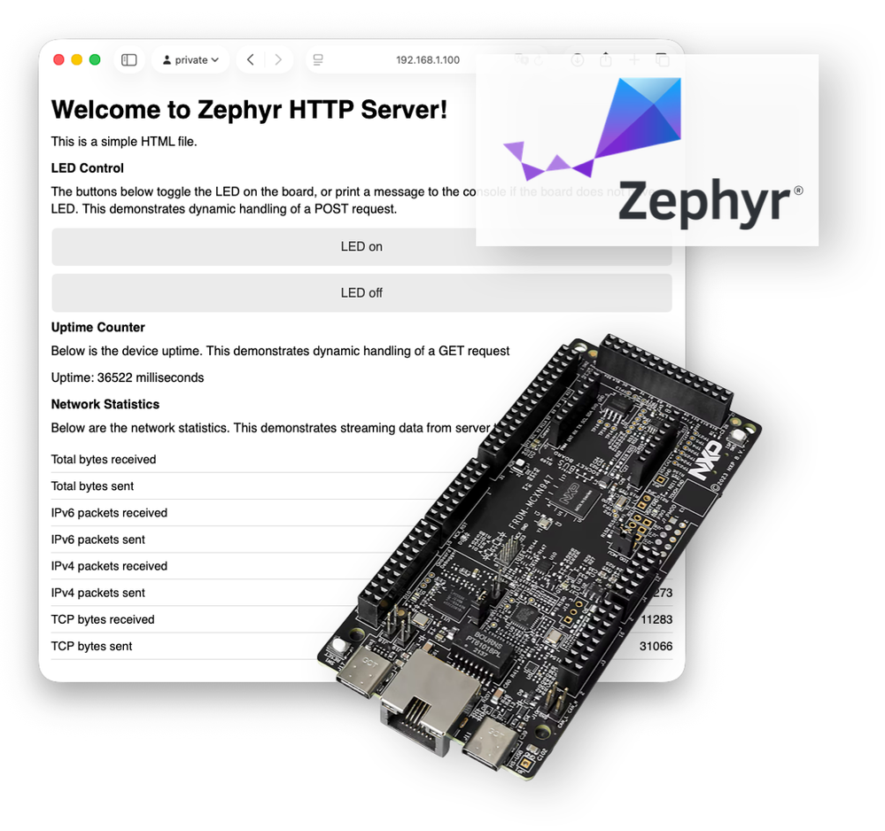

## 目次

- [0. この記事は？](#chapter0)
  - [0.1 対象読者](#0-1)
  - [0.2 この記事のゴール](#0-2)
  - [0.3 使うもの](#0-3)
  - [0.4 進め方と所要時間の目安](#0-4)
  - [0.5 この記事の読み方](#0-5)
- [1. Zephyrとは？](#chapter1)
  - [1.1 Zephyrの概要と特長](#1-1)
  - [1.2 なぜ今Zephyrなのか](#1-2)
  - [1.3 FRDM-MCXN947について](#1-3)
- [2. 開発環境を触ってみる](#chapter2)
  - [2.1 環境の確認](#2-1)
  - [2.2 Hello Worldサンプルを実行してみる](#2-2)
  - [2.3 blinkyサンプル（Lチカ）を書き込む](#2-3)
  - [2.4 サンプルコードの中身をちょっと覗いてみる](#2-4)
- [3. 温度センサーを動かしてみる](#chapter3)
  - [3.1 サンプルをビルド・書き込む](#3-1)
  - [3.2 値を確認する](#3-2)
  - [3.3 なぜ動いたのか？](#3-3)
- [4. HTTP Serverを動かしてみる](#chapter4)
  - [4.1 サンプルをビルド・書き込む](#4-1)
  - [4.2 ブラウザからLEDを制御してみる](#4-2)
  - [4.3 /uptimeエンドポイントを覗いてみる](#4-3)
- [5. HTTP Serverを改変して，温度センサーの値をブラウザで見る](#chapter5)
  - [5.1 何を追加したか](#5-1)
  - [5.2 実際にブラウザで表示してみる](#5-2)
  - [5.3 3章・4章の内容がどう組み合わさっているか](#5-3)
- [6. まとめ](#chapter6)
  - [6.1 今日体験したこと](#6-1)
  - [6.2 自分でもう一度やってみるための情報源](#6-2)
  - [6.3 AIをどう活用できるか](#6-3)
  - [6.4 後片付け](#6-4)
- [付録A. うまくいかないときは](#appendixA)
  - [A.1 まず確認すること](#A-1)
  - [A.2 PowerShell・westまわり](#A-2)
  - [A.3 ビルドのエラー](#A-3)
  - [A.4 書き込み（west flash）のエラー](#A-4)
  - [A.5 シリアルコンソールに何も出ない](#A-5)
  - [A.6 ネットワーク・ブラウザまわり](#A-6)
  - [A.7 どうしても直らないときのリセット手順](#A-7)
- [付録B. コマンド例一覧（PowerShell／bash・zsh）](#appendixB)
  - [2章 開発環境を触ってみる](#B-2)
  - [3章 温度センサーを動かしてみる](#B-3)
  - [4章 HTTP Serverを動かしてみる](#B-4)
  - [5章 HTTP Serverを改変して，温度センサーの値をブラウザで見る](#B-5)
  - [付録A うまくいかないときは](#B-A)
  - [付録C やってみよう](#B-C)
- [付録C. やってみよう（早く終わった方へ）](#appendixC)
  - [C.1 Lチカの点滅間隔を変える](#C-1)
  - [C.2 Hello Worldのメッセージを変える](#C-2)
  - [C.3 温度を華氏でも表示する](#C-3)
  - [C.4 ブラウザに表示する温度の桁数を変える](#C-4)
- [付録D. 他のFRDMボードで試すには](#appendixD)
  - [D.1 ボード名を調べる](#D-1)
  - [D.2 サンプルごとの注意](#D-2)
- [付録E. 用語集](#appendixE)
- [付録F. よくある質問](#appendixF)
- [付録G. HTTP Serverサンプルの足回り](#appendixG)

---

<a id="chapter0"></a>
## 0. この記事は？

この記事は，**ハンズオン・セミナー**「**Zephyrデビュー会**」の**進行ガイド**として書かれたものです．当日の会場では，この記事の手順に沿って一緒に手を動かしていきます．

当日参加できなかった方も，この記事だけを読みながら，同じ内容を自分の環境で再現できます．そのために，コマンド例や確認ポイントを省略せずに書いています．読み物としての解説記事というより，実際に「動くところまで」たどり着くための作業ガイドだと捉えてください．

<a id="0-1"></a>
### 0.1 対象読者

「**Zephyr**って聞いたことはあるけど触ったことはない」というZephyr OS初心者，これからZephyrを触ってみたい方に向けた記事です．組み込み開発の経験は問いません．C言語のコードを読んだことがある程度で十分です．

<a id="0-2"></a>
### 0.2 この記事のゴール

NXPのFRDM-MCXN947ボードを使って，LEDの点滅から温度センサーの読み取り，さらにブラウザ経由でセンサー値を表示するところまでを，実際に手を動かして体験します．ゴールは「Zephyrで簡単にアプリが動かせる」という成功体験を持ち帰ってもらうことです．難しい設定やコーディングは，この記事の中では最小限に留めます．

今日の流れは，図0.2-1のとおりです．2章で開発の手順に慣れ，3章と4章でそれぞれ別の機能を動かし，5章でその2つを組み合わせます．

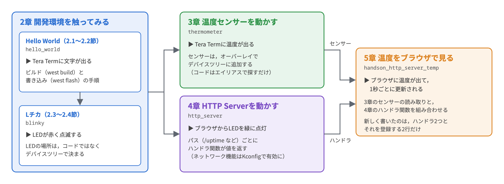

**図0.2-1** 今日の流れ

<a id="0-3"></a>
### 0.3 使うもの

- ハードウェア
  - FRDM-MCXN947評価ボード
  - PC（Zephyr開発環境など下記ソフトウェアをインストールしておく）
  - 温度センサー: P3T1755 I3C/I²Cバス対応，±0.5°C精度デジタル温度センサー (FRDM-MCXN947評価ボードに搭載)
  - Ethernetケーブル

- ソフトウェア
  - Zephyr開発環境（west（Zephyrのビルドや書き込みを行うコマンド），Zephyr SDK（コンパイラなどのツール一式），Python仮想環境を含む．公式のGetting Started Guideの手順で`~/zephyrproject`にセットアップしたもの）
  - **LinkServer**（NXPの書き込み・デバッグツール．`west flash`がFRDM-MCXN947への書き込みに使います）
  - Microsoft Visual Studio Code（ソースコードや`prj.conf`（アプリケーションごとの設定ファイル）の表示・編集に使います）
  - ターミナルソフト（本記事ではWindows用の**Tera Term**を使って説明します．macOSやLinuxで試す場合は，CoolTermなど，シリアルポートに接続できるものを使ってください）
  - ブラウザ
  - Git（5章でサンプルコードを取得するのに使います）
  - MCUXpresso for VSC（**必須ではありません**．会場PCには入っていますが，本記事の手順では使いません）

会場のPCには，これらがすべてセットアップ済みです．

> **ご自身のPCで再現する方へ**
> 会場PCと同じ状態にするには，上のソフトウェアをインストールしておく必要があります．特に**LinkServer**は見落としがちです．インストールされていない（またはPATHが通っていない）と，ビルドまではできても`west flash`で書き込めません．また，4章ではPCのEthernetポートを使うので，Ethernetポートのないノートパソコンでは，USB-Ethernetアダプタを用意してください．
>
> 【開発ツールのインストール方法を紹介したブログ記事へのリンクを挿入】

<a id="0-4"></a>
### 0.4 進め方と所要時間の目安

セミナーは90分です．おおよそ次の時間配分で進めます．

| 章 | 内容 | 目安 |
|---|---|---|
| 0〜1章 | この記事について，Zephyrとは | 10分 |
| 2章 | 開発環境の確認，Hello World，Lチカ | 25分 |
| 3章 | 温度センサーを動かす | 15分 |
| 4章 | HTTP Serverを動かす | 20分 |
| 5章 | HTTP Serverで温度を表示する | 15分 |
| 6章 | まとめ | 5分 |

【実際のタイムテーブルに合わせて調整】

**遅れてしまったら**
3章から5章は，それぞれ独立しています．前の章が終わっていなくても，新しいPowerShellでコマンド例2.1-1（会場PCでは`zinit`）を実行すれば，どの章からでも始められます．たとえば3章でつまずいたまま時間が来たら，3章はいったん置いて，4章の最初のコマンド例から進めてください．あとからこの記事を見ながら，自分のペースでやり直せます．

**早く終わったら**
記事末尾の[付録C. やってみよう](#appendixC)に，サンプルコードを少しだけ書き換えて試す課題を用意しています．

**質問するときは**
手が止まったら，遠慮なく手を挙げてください．会場のスタッフや，あとからこの記事を見ながらAIや知り合いに質問するときは，次の3つを伝えると，原因がすぐに分かります．
1. **どのコマンド例で止まったか**（コードブロックの1行目にある`# コマンド例3.1-2`のような番号）
2. **最初に出たエラーの行**（赤い文字や`error`を含む行．スクリーンショットでも構いません）
3. **[コマンド例A.1-1](#A-1)の実行結果**（今いるフォルダと，環境の設定状態が分かります）

<a id="0-5"></a>
### 0.5 この記事の読み方

2章から5章の各節は，次の順に並んでいます．会場では，まず手順を最後まで進め，「✔ ここまでできればOK」を確かめてから，解説を聞いてください．

1. **この節でやること**（1行）
2. **手順**（コマンド例）
3. **✔ ここまでできればOK**（成功したときの画面や表示）
4. **うまくいかないときは**（よくあるつまずきと対処）
5. **解説・コラム**

本文の中の囲みは，次のように使い分けています．

| 囲み | 内容 | いつ読むか |
|---|---|---|
| **注意** | 手順を進めるうえで，必ず守ってほしいこと | 手順の前に必ず読む |
| **解説** | 今やった操作やコードの意味 | 手順が終わってから．会場では講師がその場で説明します |
| **コラム** | 背景知識や，関連する話題 | 余裕があるとき，またはあとで |
| **ご自身のPCで試す場合** | 会場PC以外で再現するときの補足 | 自分のPCで試すとき |

本文に出てくる用語は，[付録E. 用語集](#appendixE)にまとめています．

---

<a id="chapter1"></a>
## 1. Zephyrとは？

<a id="1-1"></a>
### 1.1 Zephyrの概要と特長

Zephyrは，Linux Foundation配下で開発が進むオープンソースのRTOS（リアルタイムOS）です．小規模なマイコンから，比較的リソースの大きなSoCまで，幅広いハードウェアを対象にしています．

対象範囲の広さは，NXP製品だけを見ても分かります．今回使うMCXシリーズのようなCortex-Mコアのマイコンから，i.MXシリーズのようなCortex-Aコアのアプリケーションプロセッサまで，同じZephyrという1つのOSでカバーしています．ボードごとにOSやビルド環境を使い分けなくて済むのは，実用上の大きなメリットです．

特長を一言でまとめると，次の2つの仕組みで，ハードウェアの構成とソフトウェアの機能を分けて管理できる点です．
- **デバイスツリー**: 「どの部品が，どこにつながっているか」というハードウェアの構成を書くファイル
- **Kconfig**: 「どの機能を使うか」というソフトウェアの機能のオン・オフを設定する仕組み

この分離のおかげで，同じアプリケーションのコードを，複数のボードに展開しやすくなっています．

言い換えると，C言語などで書くアプリケーションのロジックは，「何のセンサーが」「どのバスに」つながっているかを直接知らなくてよい，という設計です．アプリケーションのコードは，デバイスツリーに付けた名前を使ってデバイスにアクセスするだけです．この分離を，2.4節と3.3節で実際のコードを見ながら体感します．

<a id="1-2"></a>
### 1.2 なぜ今Zephyrなのか

半導体メーカー各社が，既存製品ラインを含めZephyrへの対応を広げています．特定のベンダーに縛られないRTOSとして，業界内での存在感が増しているのが現状です．

Zephyrプロジェクトは2016年にLinux Foundation配下でスタートし，およそ10年の歴史を持ちます．新しくて枯れていない技術ではありません．

この間に積み重ねられてきたのは，CPUアーキテクチャやペリフェラルのドライバだけではありません．4章・5章で体験するTCP/IPスタックやHTTPサーバーといった，ネットワーク関連のミドルウェアも，Zephyr本体に標準で組み込まれた機能として育ってきています．マイコン向けOSというと，最小限のスケジューラだけを想像しがちです．こうした上位のミドルウェアまで，一貫してKconfigで有効にできる点も，Zephyrを選ぶ理由のひとつです．

製品に使うOSとして，セキュリティへの取り組みが整っていることも，Zephyrが注目される理由です．欧州では，ネットワークにつながる製品にサイバーセキュリティ対策を求める「サイバーレジリエンス法（CRA）」が施行され，2026年9月からは，悪用された脆弱性の報告がメーカーの義務になっています．Zephyrプロジェクトは，脆弱性への対応や長期サポートの体制を整え，こうした要求に応える準備を進めています（下のコラム）．

「結局何がそんなによいのか」は，触ってみないと実感しにくい部分です．この記事では，実際に手を動かしながらその感触を確かめていきます．

> **コラム: Zephyrのセキュリティへの取り組み**
> - 脆弱性に対応する専門チーム（PSIRT）があり，2017年からCVE番号を割り当てる機関（CNA）に登録されています．報告を受けてから，30日以内にメーカーへの通知と修正の公開を，最長90日で公表することを目標にしています．
> - 製品メーカーは，脆弱性の通知（Vulnerability Alert Registry）に登録して，情報を受け取れます．
> - 製品向けの長期サポート版（LTS）は，セキュリティ修正を含めて少なくとも5年間保守されます．
> - `west spdx`で，製品に含まれるソフトウェアの一覧（SBOM）を作れます．
> - 暗号機能はPSA Crypto（実装はMbed TLS）で提供されます．FRDM-MCXN947には，TrustZoneを使うTF-Mと組み合わせるボード指定（`frdm_mcxn947/mcxn947/cpu0/ns`）も用意されています．
>
> CRAとZephyrの関係は，Zephyrの公式ドキュメントの[Cyber Resilience Act](https://docs.zephyrproject.org/latest/security/standards/cyber-resilience-act.html)のページにまとめられています．なお，このハンズオンでは手順を簡単にするため，暗号化しないプレーンHTTPを使っています（[4.1節](#4-1)の解説）．

<a id="1-3"></a>
### 1.3 FRDM-MCXN947について

FRDM-MCXN947は，NXPのMCX N947マイコンを搭載した評価ボードです．150MHzで動作するCortex-M33のデュアルコア構成です．GPIO・I2C・I3C・SPI・Ethernetなどのペリフェラルを，ArduinoヘッダやmikroBusソケットなどのコネクタ経由で扱えます．

本記事では，ボード上の次の部品を使います（図1.3-1）．以降の本文では，「図1.3-1の①」のように，この番号で場所を示します．

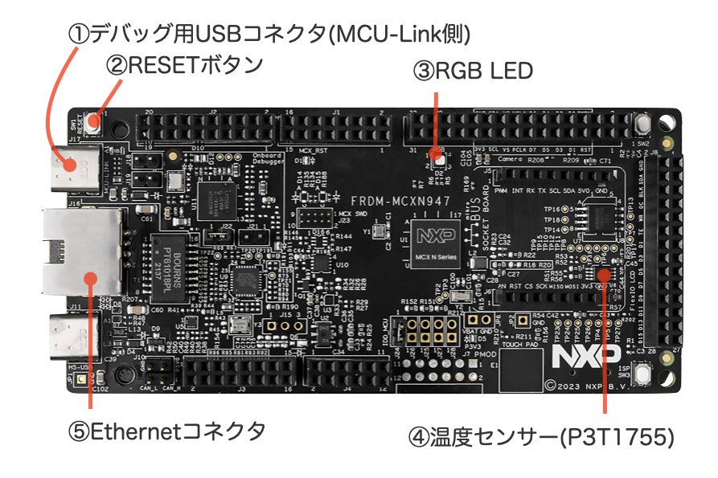

**図1.3-1** FRDM-MCXN947で使う部品

| 番号 | 部品 | 使う場面 |
|---|---|---|
| ① | デバッグ用USBコネクタ（MCU-Link側） | PCとの接続．書き込み（`west flash`）とシリアルコンソールの両方に使います．電源もここから供給されます．MCU-Linkは，ボードに載っている書き込み・デバッグ用の回路です |
| ② | RESETボタン | プログラムを最初から実行し直したいとき（シリアルの出力を見逃したときなど） |
| ③ | RGB LED | 2.3節のLチカ（赤く点滅），4.2節のブラウザからのLED制御（緑に点灯） |
| ④ | 温度センサー（P3T1755） | 3章，5章 |
| ⑤ | Ethernetコネクタ（RJ45） | 4章，5章でPCとEthernetケーブルで直結します |

> **注意**: ボードにはUSBコネクタが複数あります．①以外のUSBコネクタにつなぐと，書き込みもシリアルコンソールも使えません．

---

<a id="chapter2"></a>
## 2. 開発環境を触ってみる

<a id="2-1"></a>
### 2.1 環境の確認

この節では，PowerShellを開いて，Zephyrのコマンド（west）が使える状態になっていることを確認します．

会場のPCには，west・Zephyr SDKを含む開発環境を，公式のGetting Startedガイドの手順でセットアップしてあります．皆さんが環境構築で手間取る必要はありません．MCUXpresso for VSCも使える状態ですが，このセミナーではあえてコマンドラインで操作します．特定のチップベンダーに依存せず，どのボードでも共通の手順で扱えるからです．

**1. PowerShellを開く**

スタートメニューで「PowerShell」と入力し，「Windows PowerShell」を起動してください（図2.1-1）．このとき，「管理者として実行」は**選ばないでください**．このセミナーの手順に管理者の権限は必要なく，管理者として起動すると，コマンドを間違えたときの影響がPC全体に及ぶおそれがあるためです．管理者として起動したかどうかは，ウィンドウのタブ（またはタイトル）の先頭に「管理者:」と付いているかで見分けられます．

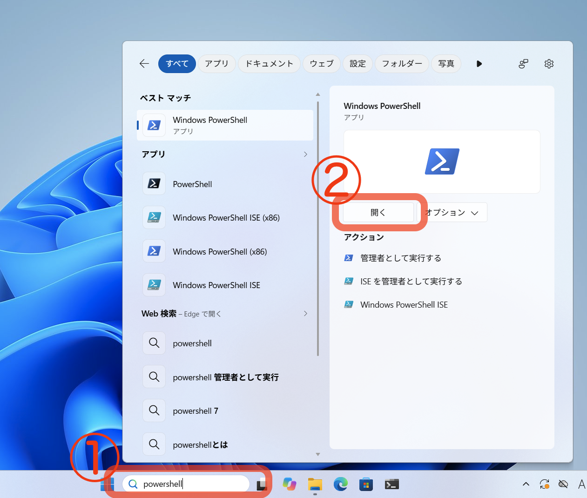

**図2.1-1** スタートメニューから「Windows PowerShell」を開く

PowerShellは，起動のしかたによって最初にいるフォルダ（カレントディレクトリ）が違います．図2.1-2のように，管理者として起動していなくても`PS C:\WINDOWS\system32>`と表示されることがあります．ホームフォルダ（`C:\Users\<ユーザー名>`）で開くこともありますし，VSCodeのターミナルでは開いているフォルダになります．どこで開いても，次のコマンド例の最初の`cd`でZephyrのワークスペース（`~\zephyrproject`）に移動するので問題ありません．`~`は自分のホームフォルダを表す記号です．

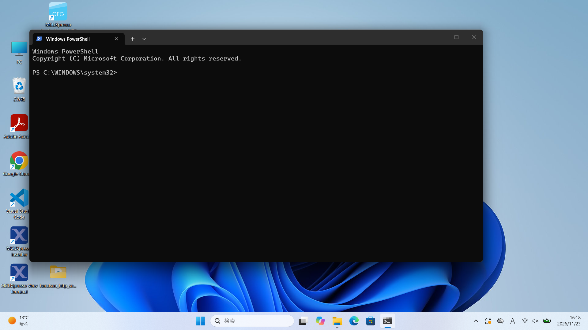

**図2.1-2** 起動したPowerShell（`C:\WINDOWS\system32`で開いた例）

**2. westを使える状態にする**

westを使う前に，Zephyr用のPython仮想環境（Zephyrのツールをまとめて入れてある，独立したPythonの環境）を有効化し，Zephyr本体の場所を環境変数`ZEPHYR_BASE`に設定します．次のコマンド例をコピーして，PowerShellに貼り付けて実行してください．

> **貼り付けるときは**
> - PowerShellのウィンドウ上で右クリックするか，`Ctrl`+`V`を押すと貼り付けられます．
> - 最後の行が入力されたまま止まっていたら，`Enter`を押して実行します．
> - 1行目の`# コマンド例…`の行も，そのまま貼り付けて構いません（PowerShellでは何もしない行です）．
>
> そのほかの注意は，この節の最後の「コラム: コマンドをコピー＆ペーストするときの注意」にまとめています．

```powershell
# コマンド例2.1-1
cd ~\zephyrproject
.\.venv\Scripts\Activate.ps1
$env:ZEPHYR_BASE = "$HOME\zephyrproject\zephyr"
west --version
west topdir
```

**✔ ここまでできればOK**
プロンプト（コマンドの入力を待っている`PS C:\...>`の表示）の先頭に`(.venv)`が付き，`west --version`でバージョンが，`west topdir`でワークスペースの場所が表示されれば準備完了です（図2.1-3）．

```text
(.venv) PS C:\Users\<ユーザー名>\zephyrproject> west --version
West version: v1.5.0
(.venv) PS C:\Users\<ユーザー名>\zephyrproject> west topdir
C:/Users/<ユーザー名>/zephyrproject
```

`west topdir`の表示は，フォルダの区切りが`\`ではなく`/`になりますが，同じ場所を指しています．

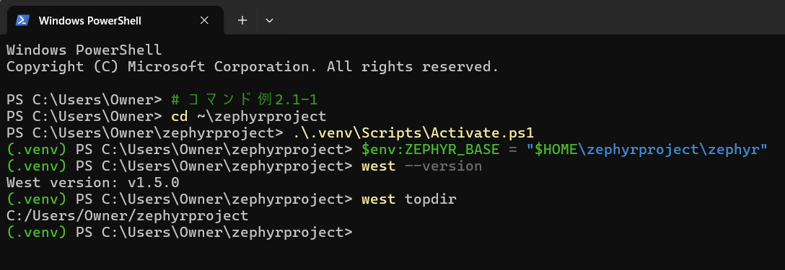

**図2.1-3** コマンド例2.1-1の実行結果

（ここから先，「実行結果の例」として載せている出力は，自分の画面と見比べるためのものです．コマンドとしてコピーしないでください．数値やバージョン番号は，環境によって異なります．）

> **注意: このPowerShellのウィンドウは閉じない**
> 仮想環境の有効化や`ZEPHYR_BASE`の設定は，**そのウィンドウの中だけ**で有効です．セミナーの間は，このウィンドウを開いたままにしておいてください．閉じてしまったときは，下の「PowerShellを開き直したときは」の手順で戻れます．

**うまくいかないときは**
- `.\.venv\Scripts\Activate.ps1`で「このシステムではスクリプトの実行が無効になっている」と赤字が出る → 下の解説の最後にある実行ポリシーの設定を行ってから，コマンド例2.1-1をもう一度最初から実行します．
- `west`が「認識されません」と出る → 仮想環境の有効化に失敗しています．プロンプトの先頭に`(.venv)`が付いているか確認してください（[A.2](#A-2)）．
- `cd`で「パスが存在しないため検出できません」と出る → ワークスペースが`~\zephyrproject`以外の場所にある可能性があります．ご自身の環境で試している場合は，ワークスペースの場所に読み替えてください．

**PowerShellを開き直したときは**

新しいPowerShellで環境を設定し直してから，作業していたサンプルのフォルダに戻ります．会場のPCには，これを一度に行う`zinit`というコマンドを用意してあります．`zinit`に続けて，作業していたサンプルの名前を指定します．たとえば3章の途中なら，次のように実行します．

```powershell
# コマンド例2.1-2
zinit thermometer
```

サンプル名は，途中まで入力して`Tab`キーを押すと補完されます．サンプル名を付けずに`zinit`だけを実行すると，コマンド例2.1-1を実行した直後と同じ状態（`~\zephyrproject`にいる状態）になります．`zinit`はVSCodeのターミナルでも使えます．

`zinit`がないPCでは，コマンド例2.1-1を実行してから，`cd ~\handson\thermometer`のようにサンプルのフォルダに移動します．コマンド例2.1-1を実行した直後は`~\zephyrproject`にいるので，そのまま`west build`を実行しても，サンプルのビルドにはなりません．

> **解説: コマンド例2.1-1で何をしているか**
> - `cd ~\zephyrproject` — Zephyrのワークスペース（west・Zephyr本体・各種モジュールをまとめて置いてあるフォルダ）に移動します．
> - `.\.venv\Scripts\Activate.ps1` — Zephyr用に用意されたPython仮想環境を有効化します．west自体やビルドに使う各種Pythonツールが，この仮想環境にインストールされています．有効化に成功すると，プロンプトの先頭に`(.venv)`と表示されます．
> - `$env:ZEPHYR_BASE = "..."` — Zephyr本体のフォルダを環境変数`ZEPHYR_BASE`に設定します．westは，カレントディレクトリから上のフォルダをたどってワークスペースを探します．この後の章では，ワークスペースの**外**にある作業用フォルダ（`~\handson\...`）でビルドします．そこからではワークスペースが見つからず，`west build`が「unknown command」になってしまいます．`ZEPHYR_BASE`を設定しておくと，westはそれを手がかりにワークスペースを見つけられます．
> - `west --version` — westコマンド自体が正しく使える状態になっているかを，バージョン表示で確認します．
> - `west topdir` — westが認識しているワークスペースの場所を表示します．ここでエラーになる場合は，`ZEPHYR_BASE`の設定を見直してください．
>
> Linux/macOSの解説記事では，`source ~/zephyrproject/.venv/bin/activate`や`source zephyr/zephyr-env.sh`という書き方をよく見かけます．これはbash/zsh用の書き方で，PowerShellではそのままでは動きません．
>
> `zephyr-env.sh`が主に行っているのは，`ZEPHYR_BASE`の設定です．そこでPowerShellでは，上のように`$env:ZEPHYR_BASE`で直接設定します．（Windows向けには`zephyr-env.cmd`も用意されていますが，これはコマンドプロンプト用です．PowerShellから実行しても，設定した環境変数はPowerShell側には残りません．）
>
> なお，`Activate.ps1`の実行時に「スクリプトの実行が無効になっている」というエラーが出る場合は，PowerShellの実行ポリシーで止められています．`Set-ExecutionPolicy -Scope CurrentUser RemoteSigned`を一度実行してから，もう一度試してください（会場PCでは設定済みです）．

> **コラム: コマンドをコピー＆ペーストするときの注意**
> - **複数行の貼り付けの確認ダイアログ**: Windows Terminalでは，複数行を貼り付けると「複数行のテキストを貼り付けようとしています」という確認が出ることがあります．そのまま貼り付けを選んでください．
> - **途中でエラーが出たら，そこで止まる**: 複数行をまとめて貼り付けると，途中の行でエラーが出ても，後ろの行が続けて実行されてしまいます．赤い文字のエラーが出たら，それより後の結果は当てにせず，エラーが出た行の原因を先に解決してください．慣れないうちは，**1行ずつ**コピーして実行するのが確実です．
> - **`# コマンド例…`の行は目印**: 質問するときや，付録Aを参照するときに，この番号を使ってください．
> - **プロンプト（`PS C:\Users\...>`）はコピーしない**: スクリーンショットや実行例に表示されているプロンプト部分は，コマンドの一部ではありません．
>
> うまくいかないときは，記事末尾の[付録A. うまくいかないときは](#appendixA)を参照してください．記事中のコマンド例は，[付録B. コマンド例一覧](#appendixB)にもまとめています．macOSやLinuxで試す方向けのbash・zsh版もそちらに載せています．

> **コラム: ご自身のPCで`zinit`を使うには**
> `zinit`は，PowerShellの**プロファイル**（PowerShellの起動時に自動で読み込まれるスクリプト）に登録した関数です．ご自身のPCでも，次のようにして同じものを用意できます．
>
> まず，次のコマンドでプロファイルをメモ帳で開きます（ファイルがなければ作ります）．
>
> ```powershell
> # コマンド例2.1-3
> if (-not (Test-Path $PROFILE.CurrentUserAllHosts)) { New-Item -Force $PROFILE.CurrentUserAllHosts | Out-Null }
> notepad $PROFILE.CurrentUserAllHosts
> ```
>
> 開いたメモ帳に，次の内容を書き加えて保存します．これはPowerShellに貼り付けて実行するコマンドではなく，**プロファイルに書く内容**です．
>
> ```
> function zinit {
>     param([string]$Sample)
>     Set-Location ~\zephyrproject
>     . .\.venv\Scripts\Activate.ps1
>     $env:ZEPHYR_BASE = "$HOME\zephyrproject\zephyr"
>     west --version
>     west topdir
>     if ($Sample) { Set-Location ~\handson\$Sample }
> }
> ```
>
> 保存したら，PowerShellのウィンドウを開き直すと`zinit`が使えるようになります．プロファイルの実行にも，この節の解説で説明した実行ポリシーの設定（`RemoteSigned`）が必要です．なお，プロファイルに日本語を書く場合は，文字コードに注意が必要です（Windows PowerShellは，BOMなしのUTF-8のファイルに含まれる日本語を正しく読めません）．上の内容は英数字だけなので，そのまま保存して構いません．

> **ご自身のPCで試す場合: 環境のセットアップ**
> 今回は会場PCに環境構築済みの状態で臨んでいただいていますが，ご自身のPCでも同じ環境を用意できます．
> - 公式ガイド: [Getting Started Guide](https://docs.zephyrproject.org/latest/develop/getting_started/index.html)
> - NXPのツールを使った簡単セットアップ: [Zephyrシリーズ 第２回 はじめてのビルドと実機動作（NXP Tech Blog，日本語）](https://community.nxp.com/t5/NXP-Tech-Blog/Zephyr-シリーズ-第２回-はじめてのビルドと実機動作-日本語ブログ/ba-p/2189007)

<a id="2-2"></a>
### 2.2 Hello Worldサンプルを実行してみる

この節では，`hello_world`サンプルをビルドしてボードに書き込み，シリアルコンソールに文字が表示されることを確認します．

これ以降，サンプルは`zephyr/samples/`の中のものを直接編集せず，自分の作業用フォルダ（`~\handson`）にコピーしてから使います（図2.2-1）．`zephyr/samples/`は元のサンプル集として手を加えずに残しておき，実験や書き換えは自分のフォルダの中だけで行います．

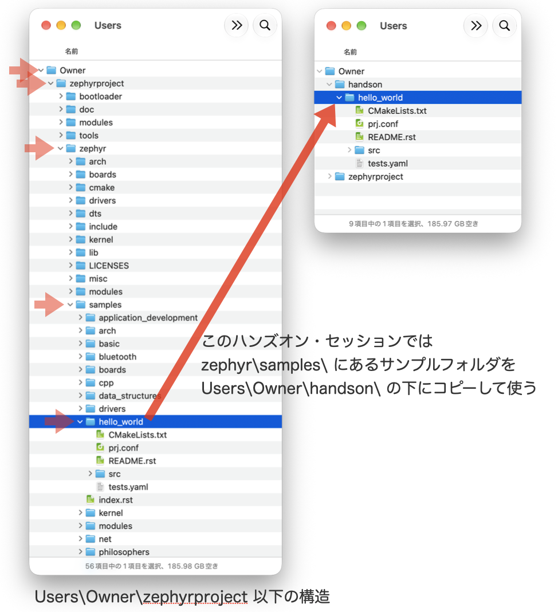

**図2.2-1** サンプルを作業用フォルダにコピーして使う

**1. サンプルを作業用フォルダにコピーする**

`hello_world`サンプルを作業用フォルダにコピーし，そのフォルダに移動します．

```powershell
# コマンド例2.2-1
New-Item -ItemType Directory -Force ~\handson | Out-Null
Copy-Item -Recurse ~\zephyrproject\zephyr\samples\hello_world ~\handson\hello_world
cd ~\handson\hello_world
```

実行後，プロンプトが`PS C:\Users\<ユーザー名>\handson\hello_world>`になっていれば移動できています．念のため`ls`を実行すると，`src`・`CMakeLists.txt`・`prj.conf`などが並んでいるはずです．

**2. ビルドする**

> **注意: 最後の` .`を忘れずに**
> 行末の` .`（スペースとピリオド）は「カレントディレクトリにあるアプリケーションをビルドする」という意味です．コピーの際に切れやすいので，貼り付けた後に確認してください．`-b`の後ろのボード名も，`/`と`//`を含めて1文字でも違うとエラーになります．手で打ち直さず，コピーしてください．

```powershell
# コマンド例2.2-2
west build -p auto -b frdm_mcxn947/mcxn947/cpu0 .
```

最初のビルドは数分かかることがあります．プロンプトが戻ってくるまで待ってください．

**✔ ここまでできればOK**
出力の最後に，次のようなFLASHやRAMの使用量の表が出ていればビルドは成功です．これで，マイコンに書き込むプログラムができました．

```text
（前略）
[xxx/xxx] Linking C executable zephyr\zephyr.elf
Memory region         Used Size  Region Size  %age Used
           FLASH:       xxxxx B         2 MB      x.xx%
             RAM:        xxxx B       320 KB      x.xx%
           SRAMX:          0 B        96 KB      0.00%
        IDT_LIST:          0 B        32 KB      0.00%
Generated files: （後略）
```

【会場PCでの実際の出力に差し替え】

エラーの場合は，そのメッセージが表示されます．Zephyrのエラーメッセージは大量になることが多く，最初は追うのが大変です．まずは**最初に出てくる`error`**の行を探すのがコツです．メッセージを注意深く読むか，AIの力を借りて把握するとよいでしょう．よくあるエラーと対処法は[A.3 ビルドのエラー](#A-3)にまとめています．

**3. 書き込みの準備をする**

書き込みの前に，次の2つを準備します．

**3-1. PCとボードをUSBケーブルでつなぐ**

図1.3-1の①（デバッグ用USBコネクタ，MCU-Link側）とPCを，USBケーブルでつなぎます（図2.2-2）．ボードのLEDが点灯して，電源が入ったことが分かります．充電専用のUSBケーブルでは通信できないので，データ通信に対応したケーブルを使ってください．

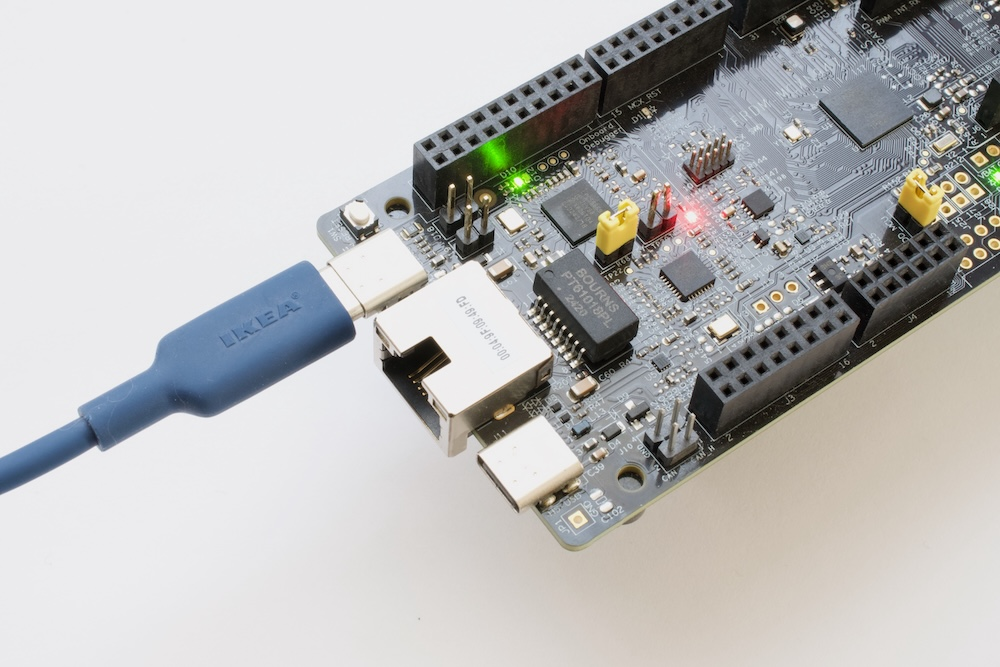

**図2.2-2** USBケーブルを図1.3-1の①につなぐ

**3-2. シリアルコンソールを開いておく**

`hello_world`は，起動直後に1回だけ文字列を出力して終わるプログラムです．書き込んだ後にシリアルコンソールを開いたのでは，出力を見逃してしまいます．そこで，**書き込む前に**シリアルコンソール（ボードの`printf`の出力などを，PCで表示する画面）を開いて接続しておきます．今回はターミナルソフトとして**Tera Term**を使います．次の「Tera Termの手順」1〜4で接続してください．

1. **Tera Termを起動する**
   デスクトップの「Tera Term 5」のアイコンから起動します（図2.2-3）．起動すると「Tera Term: 新しい接続」という画面が開きます．
2. **シリアルポートを選ぶ**
   「シリアル」を選び，「ポート」の一覧から，MCU-Link（図1.3-1の①）に対応するポートを選んで「OK」を押します（図2.2-4）．
   一覧には，`COM3: MCU-Link VCom Port (COM3)`のように`COM`＋番号の名前で表示されます．番号はPCによって異なります．
   どれか分からない場合は，ボードのUSBケーブルを抜き差しして，そのとき一覧から消えたり現れたりするポートを選んでください（一覧は「新しい接続」の画面を開き直すと更新されます）．
3. **ボーレート（シリアル通信の速度）を115200にする**
   メニューの「設定」→「シリアルポート」を選ぶと，「Tera Term: その他の設定」という画面の「シリアルポート」タブが開きます．「スピード」を`115200`にして「OK」を押します（図2.2-5）．（古いバージョンのTera Termでは，画面の名前やボタンが異なります．）
4. **文字コードをUTF-8にする** (会場のPCではこの設定は必要ありません)   
   メニューの「設定」→「端末」を開き，「漢字（受信）」（文字コードの受信側の設定）を`UTF-8`にして「OK」を押します．3章で表示する`°C`の`°`を正しく表示するための設定です．
   【Tera Term 5での画面名・項目名を確認（「その他の設定」の「エンコーディング」タブの可能性あり）】

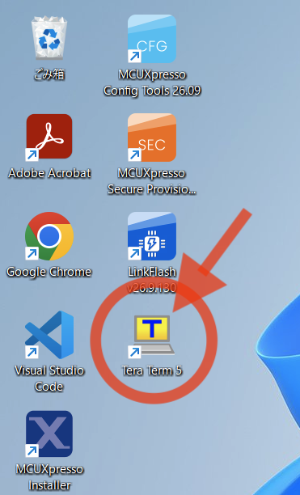

**図2.2-3** デスクトップのTera Termのアイコン

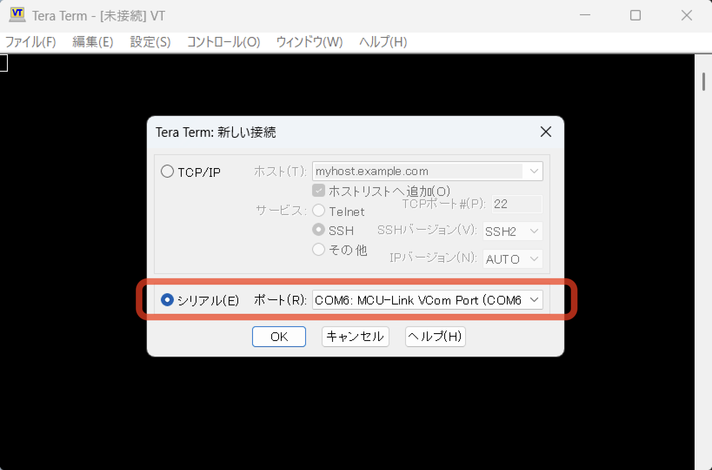

**図2.2-4** 「新しい接続」でシリアルポートを選ぶ

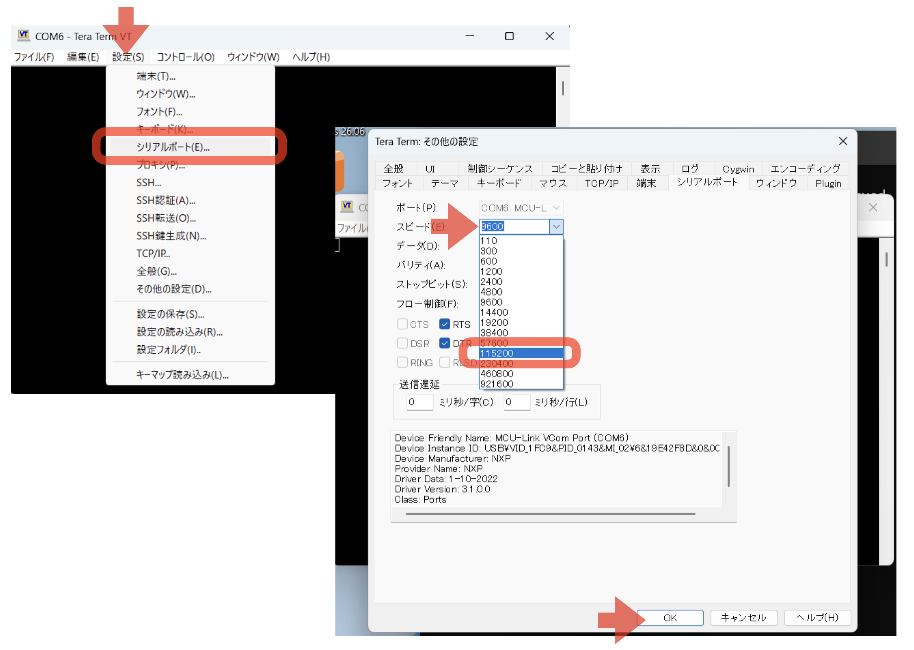

**図2.2-5** 「設定」→「シリアルポート」でスピードを115200にする

一度設定すれば，以降の章ではTera Termを開いたままで構いません．書き込みのたびに接続し直す必要はありません．

**4. 書き込む**

準備ができたら，PowerShellに戻って次のコマンドで書き込みます．

```powershell
# コマンド例2.2-3
west flash
```

書き込みが終わるとマイコンがリセットされ，書き込んだプログラムが実行されます．

**✔ ここまでできればOK**
シリアルコンソールに，次のような文字列が表示されれば成功です（図2.2-6）．

```text
*** Booting Zephyr OS build v4.x.x ***
Hello World! frdm_mcxn947/mcxn947/cpu0
```

1行目はZephyrが起動したときに必ず出すメッセージで，`v4.x.x`の部分はZephyrのバージョンです．2行目が`hello_world`のプログラムが出力した文字列です．

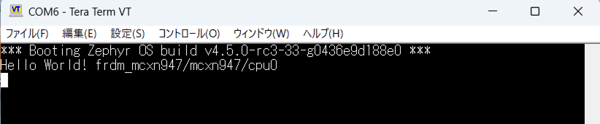

**図2.2-6** Tera TermにHello Worldが表示された画面

**うまくいかないときは**
- 書き込み前にシリアルコンソールを開き忘れて出力を見逃した → Tera Termが接続されている状態で，ボードのRESETボタン（図1.3-1の②）を押してください．プログラムが最初から実行し直され，もう一度文字列が表示されます．
- `west flash`で「プローブが見つからない（No probe found など）」というエラーが出る → USBケーブルが図1.3-1の①に挿さっているか確認します．抜き差ししてから，もう一度コマンド例2.2-3を実行します（[A.4](#A-4)）．
- 書き込みは成功したのに何も表示されない，文字化けする → Tera Termのポート，ボーレート，文字コードの設定を確認します（[A.5](#A-5)）．

<!-- CLAUDE: 
******************************************* ここまでチェックした 
-->

> **解説: 作業用フォルダへのコピー（コマンド例2.2-1）**
> 1行目の`New-Item`で，作業用フォルダ`~\handson`を作っておきます（すでにある場合は何もしません．この行は最初の1回だけで大丈夫です）．`Copy-Item -Recurse`で，`zephyr\samples\`の中のサンプルをフォルダごと作業用フォルダにコピーし，`cd`でそのフォルダに移動しています．以降の章でも同じように，触りたいサンプルをまず作業用フォルダへコピーしてから作業を始めます．
>
> `Copy-Item`は，コピー先のフォルダがすでに存在すると，その**中に**サンプルのフォルダをもう1つ作ってしまいます（例: `~\handson\hello_world\hello_world`）．コピーをやり直したいときは，先に`Remove-Item -Recurse -Force ~\handson\hello_world`で古いフォルダを消してから実行してください．

> **解説: `-b`・`-p`オプション（コマンド例2.2-2）**
> - `-b`に続く引数は，ビルド対象のボードの指定です．FRDM-MCXN947はCortex-M33のデュアルコア構成なので，`frdm_mcxn947/mcxn947/cpu0`のように「ボード名／SoC名／コア名」まで指定します．FRDM-MCXA153のようなシングルコアのボードでは，`frdm_mcxa153`というボード名だけで済みます．
> - SoC名を省略して`frdm_mcxn947//cpu0`と書くこともできます．FRDM-MCXN947のようにSoCが1つしかないボードでは，間のSoC名を省いてスラッシュだけを残しても一意に決まるためです．本記事でも，2.3節以降はこの省略形を使います．
> - `-p auto`は`--pristine=auto`の省略形です．ビルドフォルダをクリーンな状態から作り直す（pristineビルドする）かどうかを，自動で判定します．詳しくは次の解説で説明します．
> - 以降の章で登場する`west build`・`west flash`でも，これらのオプションの意味は同じです．

> **解説: ビルドでできたファイルの場所**
> ビルドが成功すると，カレントディレクトリに`build/`フォルダが作られます．書き込みに使われるのは`build/zephyr/zephyr.elf`（デバッグ情報付きのELFファイル）で，この後実行する`west flash`も，このファイルをボードに書き込みます．そのほか，コンフィグの内容は`build/zephyr/.config`，展開後のデバイスツリーは`build/zephyr/zephyr.dts`で確認できます．
>
> `--pristine`は，このビルドフォルダを作り直すかどうかを指定するオプションです．`-p auto`（`--pristine=auto`）は，ソースやコンフィグの変更を検知して，必要なときだけビルドフォルダを作り直します．ビルドの様子がおかしいときなど，明示的にクリーンビルドしたい場合は`-p always`（`--pristine=always`）を指定します．

> **ご自身のPCで試す場合（Tera Term）**
> - Tera Termの手順3と4の設定は，「設定」→「設定の保存」で保存しておくと，次回からは手順2だけで接続できます．
> - macOSやLinuxでは，Tera Termは使えません．CoolTermなどで，ポートに`/dev/tty.usbmodemXXXX`（macOS）や`/dev/ttyACM0`（Linux）を選び，ボーレートを115200にして接続してください．

**`hello_world`のコードを見てみる**

`hello_world`の`src/main.c`は，次のように驚くほど短いコードです．VSCodeでこのファイルを開くには，作業用フォルダ（`~\handson\hello_world`）をVSCodeの「Open Folder」で開き，エクスプローラーから`src/main.c`を選択してください．PowerShellから`code ~\handson\hello_world`と実行して開くこともできます．

```c
#include <stdio.h>

int main(void)
{
	printf("Hello World! %s\n", CONFIG_BOARD_TARGET);

	return 0;
}
```

これを見る限り，至って普通のC言語による`Hello World`コードです．強いて特別な点を挙げるなら，`CONFIG_BOARD_TARGET`というマクロがこのビルド環境の中で定義されているのだろう，という程度です．マイコンプログラムでよく見られるクロック設定やペリフェラルの初期化処理は，このコードのどこにも見当たりません．

このコードには，「RTOSのコードっぽくなさ」もあります．タスク（スレッド）の生成も，スケジューラの起動もありません．`main()`から`printf()`を呼ぶだけで，PC向けのC言語プログラムとほとんど同じ見た目です．

多くのRTOSでは，「Hello World」のためにもタスクを明示的に作り，`osKernelStart()`のような呼び出しでスケジューラを起動する必要があります．Zephyrでは，`main()`自体がすでに1つのスレッドとして動いています．その手前の初期化は，ビルドシステムとKconfigの設定に任されています．この「素のCプログラムに近い書き味」は，Zephyrがアプリケーション開発者に見せる顔の特徴のひとつです．

> **解説: main.c以外に必要なファイル**
> Zephyrアプリケーションとして最低限必要なのは，`src/main.c`のほかに`prj.conf`と`CMakeLists.txt`の2つです．
> - `prj.conf`は，そのアプリケーションで使うKconfigの機能を並べる設定ファイルです．`hello_world`では特に有効にしたい機能がないため，中身はほぼ空です．
> - `CMakeLists.txt`は，ビルドの定義ファイルです．`find_package(Zephyr ...)`でZephyrのビルドシステムを読み込み，`target_sources()`でビルドするソースファイルを指定します．
>
> 実際に`zephyr/samples/hello_world/`の中を見ても，ファイルは`CMakeLists.txt`・`prj.conf`・`src/main.c`（と説明用の`README.rst`）程度しかありません．Zephyrアプリケーションの最小構成は，この3点セットです．

<a id="2-3"></a>
### 2.3 blinkyサンプル（Lチカ）を書き込む

この節では，`blinky`サンプルを書き込んで，ボードのLEDを点滅させます．手順はHello Worldと同じで，コピーするサンプルが変わるだけです．これ以降，ボードの指定には，2.2節の解説で触れた省略形`frdm_mcxn947//cpu0`を使います．

```powershell
# コマンド例2.3-1
Copy-Item -Recurse ~\zephyrproject\zephyr\samples\basic\blinky ~\handson\blinky
cd ~\handson\blinky
```

プロンプトが`...\handson\blinky>`になったことを確認してから，ビルドします．

> **注意: ビルドと書き込みは分けて実行する**
> `west build`と`west flash`を一度に貼り付けると，ビルドが失敗しても`west flash`が続けて実行されます．そうなると，最後に表示されるのは`west flash`側のエラーなので，本当の原因（ビルドのエラー）が画面の上の方に流れてしまいます．ビルドが成功したのを確認してから書き込む，という順序を守ると，どこで失敗したのかがすぐ分かります．

```powershell
# コマンド例2.3-2
west build -p auto -b frdm_mcxn947//cpu0 .
```

ビルドが成功したこと（最後にメモリ使用量の表が出ていること）を確認してから，書き込みます．

```powershell
# コマンド例2.3-3
west flash
```

**✔ ここまでできればOK**
ボード上のRGB LED（図1.3-1の③）が，赤色で1秒ごとに点滅すれば成功です（図2.3-1）．Tera Termを接続したままにしておくと，点滅に合わせて次のような表示も流れてきます．

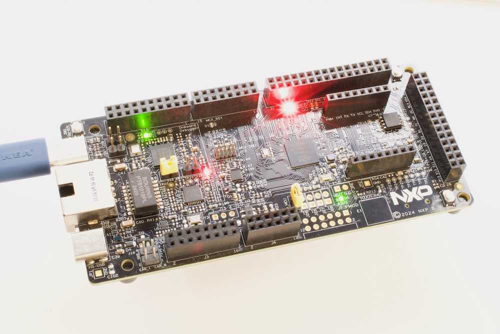

**図2.3-1** blinkyでRGB LEDが赤く点滅する

```text
*** Booting Zephyr OS build v4.x.x ***
LED state: OFF
LED state: ON
LED state: OFF
LED state: ON
```

**うまくいかないときは**
- プロンプトが`...\hello_world>`のままで`west build`を実行してしまった → `hello_world`がもう一度ビルドされるだけで，害はありません．コマンド例2.3-1の`cd`からやり直してください．
- `Copy-Item`を2回実行してしまった → `~\handson\blinky\blinky`という入れ子のフォルダができますが，`~\handson\blinky`でのビルドには影響しません．気になる場合は，2.2節の解説の方法で消してからコピーし直してください．

<a id="2-4"></a>
### 2.4 サンプルコードの中身をちょっと覗いてみる

この節では，`blinky`のコードを見ながら，LEDの場所がどこで決まっているのかを確かめます．

`blinky`の`src/main.c`を開くと，GPIOをトグルするだけの短いコードになっていることが分かります．

```c
/* 1000 msec = 1 sec */
#define SLEEP_TIME_MS   1000

/* The devicetree node identifier for the "led0" alias. */
#define LED0_NODE DT_ALIAS(led0)

static const struct gpio_dt_spec led = GPIO_DT_SPEC_GET(LED0_NODE, gpios);
```

（抜粋）

ここで注目したいのは，コードのどこにも「どのピンにLEDがつながっているか」が書かれていないことです．コードが指定しているのは，`led0`という**エイリアス**（別名）だけです．`led0`が実際にどのLEDを指すのかは，Zephyr本体側にあるボードの**デバイスツリー**（ハードウェアの構成を書いたファイル．`zephyr/boards/nxp/frdm_mcxn947/frdm_mcxn947.dtsi`）で，次のように定義されています．

```dts
aliases {
	led0 = &red_led;
	...
};

red_led: led_3 {
	gpios = <&gpio0 10 GPIO_ACTIVE_LOW>;
	label = "Red LED";
};
```

（抜粋）

「`led0`はRGB LEDの赤（GPIO0の10番ピン）だ」という情報がボード側に書かれているので，アプリケーションは`led0`と言うだけで済みます．`blinky`のフォルダには，FRDM-MCXN947向けの追加設定（`boards/`フォルダに置くオーバーレイ．ボードのデバイスツリーに差分を重ねるファイルで，3.3節で説明します）もありません．ボード側の定義だけで，そのまま動いているわけです．同じ`blinky`が，`led0`を定義しているどのボードでもそのまま動くのはこのためです．

アプリケーション・デバイスツリー・Kconfig・ドライバの関係を図にすると，図2.4-1のようになります．**Kconfig**は，Zephyrの機能のオン・オフを設定する仕組みです（3章でもう一度触れます）．

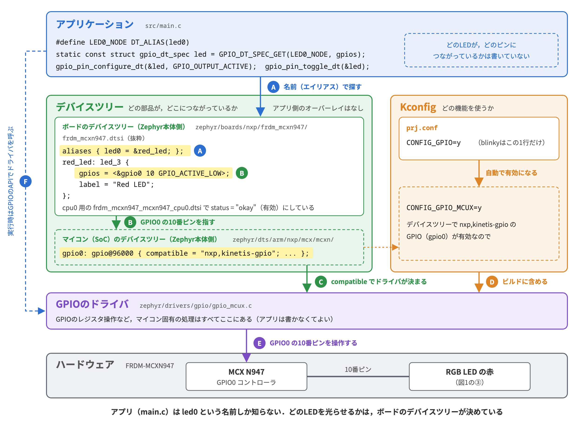

**図2.4-1** blinkyでの，アプリケーション・デバイスツリー・Kconfig・ドライバの関係

> **コラム: MCXなのに「kinetis」？**
> 図の`compatible = "nxp,kinetis-gpio"`にある`kinetis`は，NXPの以前のマイコンシリーズ（Kinetis）の名前です．MCXのGPIOはKinetisと同じ系統の回路なので，Zephyrでは新しい名前を作らず，同じ名前・同じドライバ（`gpio_mcux.c`）を使っています．

ここで出てきた「デバイスツリー」は，3章で温度センサーの仕組みを説明するときにもう一度登場します．3章では，ボード側の定義だけでは足りない部分を，アプリケーション側のオーバーレイで追加する例を見ます．

---

<a id="chapter3"></a>
## 3. 温度センサーを動かしてみる

<a id="3-1"></a>
### 3.1 サンプルをビルド・書き込む

この節では，ボードに載っている温度センサーを読む`thermometer`サンプルを書き込みます．2章と同じように，作業用フォルダにコピーしてからビルド・書き込みます．

```powershell
# コマンド例3.1-1
Copy-Item -Recurse ~\zephyrproject\zephyr\samples\sensor\thermometer ~\handson\thermometer
cd ~\handson\thermometer
```

```powershell
# コマンド例3.1-2
west build -p auto -b frdm_mcxn947//cpu0 .
```

ビルドが成功したら，Tera Termが接続されたままか確認してから書き込みます（閉じてしまった場合は，2.2節の手順で接続し直します）．

```powershell
# コマンド例3.1-3
west flash
```

<a id="3-2"></a>
### 3.2 値を確認する

**✔ ここまでできればOK**
シリアルコンソールに，1秒ごとに気温の値が表示されます（図3.2-1）．温度センサー（[図1.3-1](#1-3)の④）を指で触ると，少しずつ値が上がっていくのが分かります．

```text
*** Booting Zephyr OS build v4.x.x ***
Thermometer Example (arm)
Temperature device is 0x1000b23c, name is p3t1755@4800000236152a0090
Temperature is 25.9°C
Temperature is 25.8°C
Temperature is 25.8°C
```

最初の数行は，サンプルの起動メッセージです．`name is p3t1755@4800000236152a0090`の行から，3.3節で説明するデバイスツリーの定義どおり，P3T1755が温度センサーとして使われていることが分かります．（`0x1000b23c`の部分は，ビルドによって変わることがあります．）

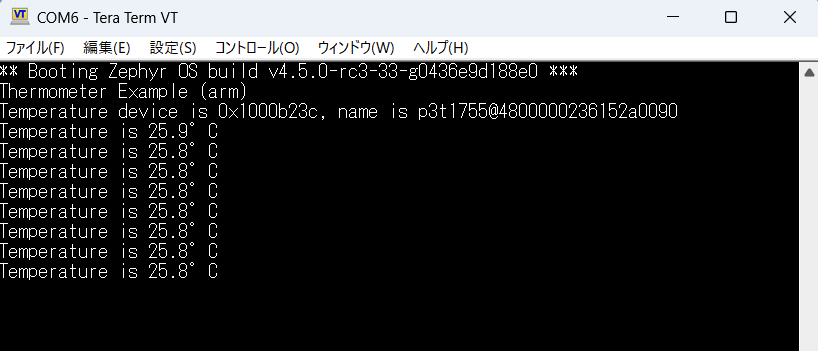

**図3.2-1** Tera Termに温度が表示された画面

**うまくいかないときは**
- 何も表示されない → Tera Termのタイトルバーに`COM3 - Tera Term VT`のようにCOMポートが表示されているか（接続中か）を確認し，ボードのRESETボタンを押します（[A.5](#A-5)）．
- `°C`の部分が文字化けする → Tera Termの文字コード設定によるもので，動作には問題ありません．気になる場合は，2.2節のTera Termの手順4で受信の文字コードを`UTF-8`にしてください．
- `Device ... is not ready`のようなメッセージが出る → センサーの初期化に失敗しています．別のサンプル（`hello_world`など）を書き込んでいないか，`cd ~\handson\thermometer`でこのサンプルのフォルダにいる状態でビルドしたかを確認し，コマンド例3.1-2からやり直します．

<a id="3-3"></a>
### 3.3 なぜ動いたのか？

この節では，センサーの値がなぜ表示されたのかを，`src/main.c`と`boards/*.overlay`を見ながら種明かしします．

`main.c`側では，センサーデバイスを次のように取得しています．

```c
static const struct device *const temp_dev = DEVICE_DT_GET(DT_ALIAS(ambient_temp0));
```

この`ambient_temp0`というエイリアスが，実際にどのハードウェア（センサーの品種・接続バス）を指すのかを決めているのが，`boards/*.overlay`です．**オーバーレイ**は，ボード本体のデバイスツリーに，アプリケーションごとの差分を重ねるファイルです．

今回のFRDM-MCXN947では，温度センサーはI3Cバスにつながっています．`boards/frdm_mcxn947_mcxn947_cpu0.overlay`には，次のように定義されています（実際のファイルにはI3Cバスのクロック速度の指定なども含まれますが，ここでは要点を抜粋しています）．

```dts
/ {
	aliases {
		ambient-temp0 = &p3t1755;
	};
};

&i3c1 {
	status = "okay";

	p3t1755: p3t1755@4800000236152a0090 {
		compatible = "nxp,p3t1755";
		reg = <0x48 0x0236 0x152a0090>;
		status = "okay";
	};
};
```

やっていることは2つだけです．
- `aliases`ブロックで，`ambient-temp0`を`p3t1755`ノードに結び付ける
- `i3c1`バスの下に，`nxp,p3t1755`ドライバを使うセンサーのノードを1つ追加する

`main.c`側は`DT_ALIAS(ambient_temp0)`としか書いていません．このセンサーがI2Cではなく（より高速な）I3Cでつながっていることも，レジスタアドレスの詳細も，アプリケーションのコードは一切知りません．

ここでの見どころは，「コードを一行も書かずに，デバイスツリーの定義を変えるだけで別のハードウェア構成に対応できる」ことです．たとえば，同じセンサーをI2C接続のボードに載せ替えたり，別の温度センサーIC（対応ドライバがある前提）に変えたりする場合を考えます．変更するのは基本的に`boards/*.overlay`の中だけで，`main.c`の`DEVICE_DT_GET(DT_ALIAS(ambient_temp0))`という1行はそのまま使い回せます．この関係を図にすると，図3.3-1のようになります．

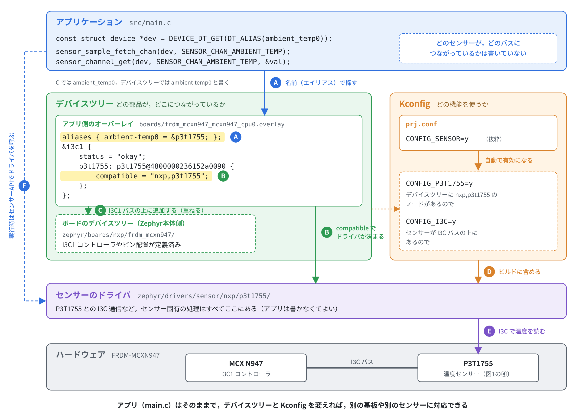

**図3.3-1** thermometerでの，アプリケーション・デバイスツリー・Kconfig・ドライバの関係

> **解説: デバイスツリーの実体はどこにあるのか**
> 1. FRDM-MCXN947のボード自体が持つデバイスツリーの本体は，Zephyr本体側の`zephyr/boards/nxp/frdm_mcxn947/frdm_mcxn947_mcxn947_cpu0.dts`（および共通定義の`frdm_mcxn947.dtsi`）です．ここには，ボードに標準で載っているペリフェラル一式が定義されています．
> 2. このボード本体のデバイスツリーファイルは，直接書き換えません．Zephyrでは，アプリケーション側に，ボード本体の定義へ**追記・上書きするための差分ファイル**（オーバーレイ，`*.overlay`）を置きます．
>    thermometerでは`samples/sensor/thermometer/boards/frdm_mcxn947_mcxn947_cpu0.overlay`，5章で使うリポジトリでは`boards/frdm_mcxn947_mcxn947_cpu0.overlay`です．本文で示した`p3t1755`ノードの定義も，このオーバーレイの中身です．ボード本体の定義はそのままに，アプリケーションごとに必要な差分だけを重ねられるのが利点です．
> 3. ビルドすると，ボード本体のデバイスツリーとアプリケーションのオーバーレイがマージされ，最終的なデバイスツリー全体が`build/zephyr/zephyr.dts`に書き出されます．このファイルを開くと，`p3t1755`ノードがボード本体の定義に追加されていることを確認できます．
>
> OSを使わないベアメタル開発や，デバイスツリーの仕組みを持たない多くのRTOSでは，センサーのI2C/I3Cアドレスやレジスタ操作を，アプリケーションのコードの中に直接書くのが一般的です．そのため，センサーの型番やバスの配線が変わるたびに，アプリケーションのロジックを書き換える必要があります．Zephyrでは，「どの部品が」「どこに」つながっているかという情報をデバイスツリーという別の層に追い出しています．そのため，ボードが変わっても，アプリケーションのロジック（この場合は「気温を読んで表示する」という処理）そのものは触らずに済みます．
>
> 興味を持った方は，他のボード向けの`overlay`ファイルも見比べてみてください．同じ`samples/sensor/thermometer`でも，ボードごとにハードウェアの接続だけが違う`overlay`が用意されていることが分かるはずです．

---

<a id="chapter4"></a>
## 4. HTTP Serverを動かしてみる

この章では，PCとボードをEthernetケーブルでつなぎ，ボード上で動くHTTP Serverにブラウザからアクセスします（図4.1-1）．これまではボード単体で完結していましたが，ここから一歩進めます．

使うのは，Zephyr公式サンプルの`samples/net/sockets/http_server`です．そのままビルド・書き込みして，ブラウザからLEDを点灯/消灯したり，シンプルな**エンドポイント**（`/uptime`のような，URLのパスごとに用意された窓口）の応答を確認したりします．5章では，この仕組みを土台にして，温度センサーの値をブラウザで見られるように拡張します．

FRDM-MCXN947でHTTP Serverサンプルを動かす手順自体は，単発のブログ記事としてすでに公開されています．PC側のネットワーク設定や，固定IPの代わりにDHCPを使う場合の手順など，より詳しい内容はそちらも参照してください．

- [Zephyr HTTP ServerをFRDM-MCXN947で動かしてみた（NXP Tech Blog，日本語）](https://community.nxp.com/t5/NXP-Tech-Blog/Zephyr-HTTP-Server%E3%82%92FRDM-MCXN947%E3%81%A7%E5%8B%95%E3%81%8B%E3%81%97%E3%81%A6%E3%81%BF%E3%81%9F-%E6%97%A5%E6%9C%AC%E8%AA%9E%E3%83%96%E3%83%AD%E3%82%B0/ba-p/2379867)

<a id="4-1"></a>
### 4.1 サンプルをビルド・書き込む

この節では，`http_server`サンプルのIPアドレスを書き換えてから書き込み，PCから`ping`で応答があることを確認します．今回は，TLSを使わないプレーンHTTPと，固定IPで進めます．

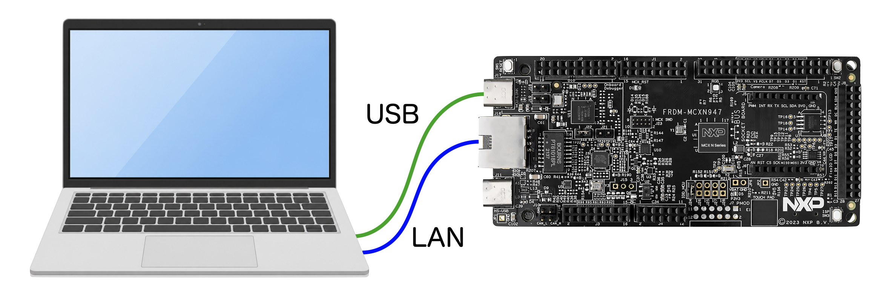

**図4.1-1** PCとボードの接続とIPアドレス（USBケーブルとEthernetケーブル）

**1. サンプルを作業用フォルダにコピーする**

```powershell
# コマンド例4.1-1
Copy-Item -Recurse ~\zephyrproject\zephyr\samples\net\sockets\http_server ~\handson\http_server
cd ~\handson\http_server
```

**2. `prj.conf`のIPアドレスを書き換える**

次のコマンドを実行すると，VSCodeで`prj.conf`が開きます．

```powershell
# コマンド例4.1-2
code prj.conf
```

VSCodeの上部に「Restricted Mode is intended for safe code browsing.」という帯が表示されることがあります（後の図4.1-2の上部にも写っています）．これは，開いたファイルを安全のため機能を制限したモードで表示している，という案内です．`prj.conf`の編集・保存には影響しないので，そのまま進めて構いません．

ボードに固定IPアドレスを持たせるため，`CONFIG_NET_CONFIG_MY_IPV4_ADDR`の行を書き換えます．ファイルの中ほどにある`# Network address config`の下を見てください．元のサンプルでは，次のようになっています．

```
CONFIG_NET_CONFIG_MY_IPV4_ADDR="192.0.2.1"
CONFIG_NET_CONFIG_PEER_IPV4_ADDR="192.0.2.2"
CONFIG_NET_CONFIG_MY_IPV4_GW="192.0.2.2"
```

1行目の`"`で囲まれた値を，次のように書き換えます．

```
CONFIG_NET_CONFIG_MY_IPV4_ADDR="192.168.1.100"
```

3行目の`CONFIG_NET_CONFIG_MY_IPV4_GW`は，Gateway（ルーター）のアドレスです．PCとボードを直結する今回の構成では使われないので，書き換えなくても構いません．書き換える場合は`"192.168.1.1"`にします（この節の最後の解説を参照）．2行目の`CONFIG_NET_CONFIG_PEER_IPV4_ADDR`は似ていますが別の設定で，今回は書き換えません．

> **注意: この行はPowerShellに貼り付けない**
> 上の`CONFIG_...`の行はコマンドではなく，VSCodeで開いた`prj.conf`ファイルの**中身**です．PowerShellに貼り付けると「認識されません」というエラーになります（ファイルには何も影響しないので，間違えて貼り付けても問題はありません）．
> - 元の行を**書き換えて**ください．元の行を残したまま末尾に行を追加すると，同じ設定が2回書かれた状態になり，どちらが有効か分かりにくくなります．
> - Gatewayも書き換える場合: `PEER_IPV4_ADDR`の行と`MY_IPV4_GW`の行は，元の値がどちらも`"192.0.2.2"`です．値で探すと`PEER`の行を書き換えてしまいやすいので，行の先頭の`CONFIG_...`の名前で確かめてください．
> - 値を囲む`"`（ダブルクォーテーション）は消さないでください．
> - 編集したら，**`Ctrl`+`S`で保存**します．VSCodeのタブのファイル名の横に`●`が付いている間は，まだ保存されていません．保存し忘れると，元のIPアドレスのままビルドされてしまいます．

図4.1-2は，`MY_IPV4_ADDR`の行を書き換えて保存したところです（`MY_IPV4_GW`の行は元のままにしています）．

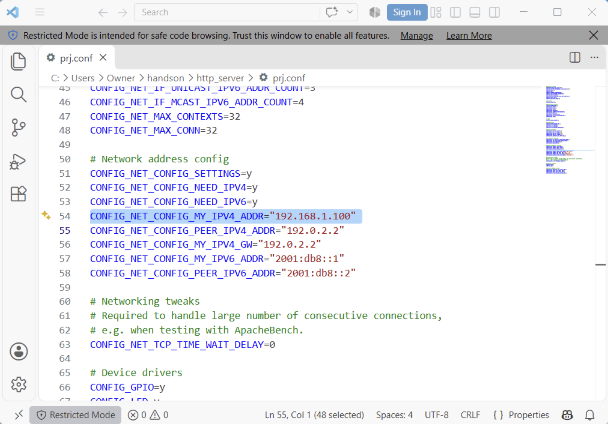

**図4.1-2** `prj.conf`の`MY_IPV4_ADDR`を書き換えて保存したところ

会場のPC側のIPアドレスは，あらかじめこのボードと同じ`192.168.1.0/24`のサブネットに収まるよう設定済みです．PC側の設定を変更する必要はありません．

<!-- CLAUDE: 
************************************ チェックとコメント追加はここまで 2026-08-18
-->

**3. ビルドして書き込む**

`prj.conf`を保存したら，PowerShellのウィンドウに戻ってビルドします．VSCodeの画面のままコマンドを貼り付けないよう注意してください．

```powershell
# コマンド例4.1-3
west build -p auto -b frdm_mcxn947//cpu0 .
```

ビルドが成功したら書き込みます．

```powershell
# コマンド例4.1-4
west flash
```

書き込みの途中で，`INFO: MCU-Link firmware update 'check': ... is running a firmware version which is older than the included firmware version`のような表示が出ることがあります．ボードのMCU-Linkのファームウェアが，LinkServerに付属しているものより古いという案内です．書き込みはそのまま行われるので，気にせず進めてください．

**4. Ethernetケーブルをつないで，応答を確認する**

書き込みが終わったら，PCとボードをEthernetケーブルで直結します．ケーブルを挿すのは，ボードのEthernetコネクタ（[図1.3-1](#1-3)の⑤）です（図4.1-3）．

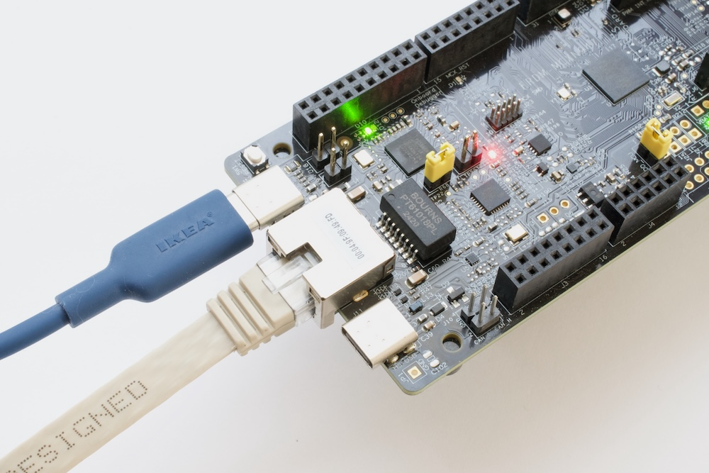

**図4.1-3** EthernetケーブルをボードのEthernetコネクタに挿す

ボードがネットワークを使えるようになるまで数秒かかります．少し待ってから，PowerShellで次のコマンドを実行してください．

```powershell
# コマンド例4.1-5
ping 192.168.1.100
```

**✔ ここまでできればOK**
次のように`192.168.1.100 からの応答`と表示されれば，PCとボードの間で通信できています（図4.1-4）．

```text
192.168.1.100 に ping を送信しています 32 バイトのデータ:
192.168.1.100 からの応答: バイト数 =32 時間 <1ms TTL=64
192.168.1.100 からの応答: バイト数 =32 時間 <1ms TTL=64
192.168.1.100 からの応答: バイト数 =32 時間 <1ms TTL=64
192.168.1.100 からの応答: バイト数 =32 時間 <1ms TTL=64

192.168.1.100 の ping 統計:
    パケット数: 送信 = 4、受信 = 4、損失 = 0 (0% の損失)、
ラウンド トリップの概算時間 (ミリ秒):
    最小 = 0ms、最大 = 0ms、平均 = 0ms
```

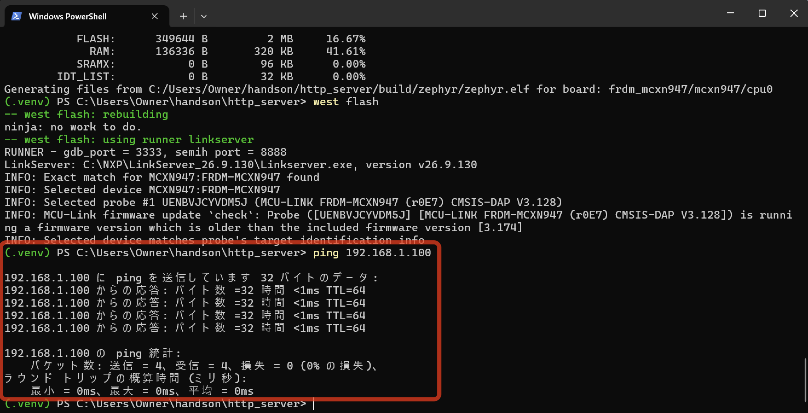

**図4.1-4** `ping`の実行結果

**うまくいかないときは**
- 「要求がタイムアウトしました」と表示される → 次の順に確認します．
  1. Ethernetケーブルが，PCとボードの両方にしっかり挿さっているか．ボード側のコネクタのLEDが点灯しているか．
  2. `prj.conf`のIPアドレスが`192.168.1.100`になっていて，**保存されているか**．保存し直した場合は，コマンド例4.1-3からビルドと書き込みをやり直します．
  3. シリアルコンソール（Tera Term）に，ボードの起動メッセージやIPアドレスの表示が出ているか．何も出ていなければ，RESETボタンを押してみます．
  4. それでもだめなら，[A.6](#A-6)を参照してください．
- 「宛先ホストに到達できません」と表示される → PC側のIPアドレスが`192.168.1.x`になっていない可能性があります（[A.6](#A-6)）．

> **解説: なぜプレーンHTTPを使うのか**
> プレーンHTTPは，通信内容が暗号化されないHTTP通信です．実運用では，盗聴や改ざんを防ぐため，TLSで暗号化されたHTTPSの利用が推奨されます．HTTPSを使うには，サーバー証明書や秘密鍵といった認証まわりのファイルを，あらかじめ用意する必要があります．
>
> Zephyrでも，こうした認証の仕組みや，通信を暗号化する仕組みはサポートされています．しかし今回のハンズオンでは，限られた時間の中で認証ファイルの準備を省き，HTTP Serverそのものの仕組みを体験することに集中するため，あえてプレーンHTTPを使います．

> **解説: Gatewayの設定について**
> Gateway（`CONFIG_NET_CONFIG_MY_IPV4_GW`）は，ルーターを経由しない通信では本来必須ではありません．今回はPCとボードをEthernetケーブルで直結し，同じ`192.168.1.0/24`のサブネットに両方を置きます．通信はすべて同一リンク内のARPで解決され，Gatewayを経由するルーティングは発生しません．そのため今回は，元の値のままでも，`"192.168.1.1"`に書き換えても，同じように動きます．
>
> ボードをルーターにつないで別のネットワークと通信する場合は，そのルーターのアドレスに書き換える必要があります．

<a id="4-2"></a>
### 4.2 ブラウザからLEDを制御してみる

この節では，ブラウザからボードのLEDを点灯/消灯します．

> **注意: アドレスは`http://`から入力する**
> ブラウザのアドレス欄には，`http://`を省略せず`http://192.168.1.100/`のように入力してください．
>
> 最近のブラウザは，`http://`を省略したり古い履歴を選んだりすると，自動的に暗号化通信の`https://`で接続しようとします．今回のボードはプレーンHTTPで動いているので，`https://`では接続できません．「接続がプライベートではありません」「安全な接続をサポートしていません」のような画面が出た場合は，アドレス欄が`https://`になっていないか確認してください．
>
> なお，ページが表示されたとき，アドレス欄の左に「保護されていない通信」と表示されます．暗号化していないプレーンHTTPで接続しているためで，今回はこれで正常です．

ブラウザで`http://192.168.1.100/`にアクセスすると，LED制御用のページが表示されます（図4.2-1）．

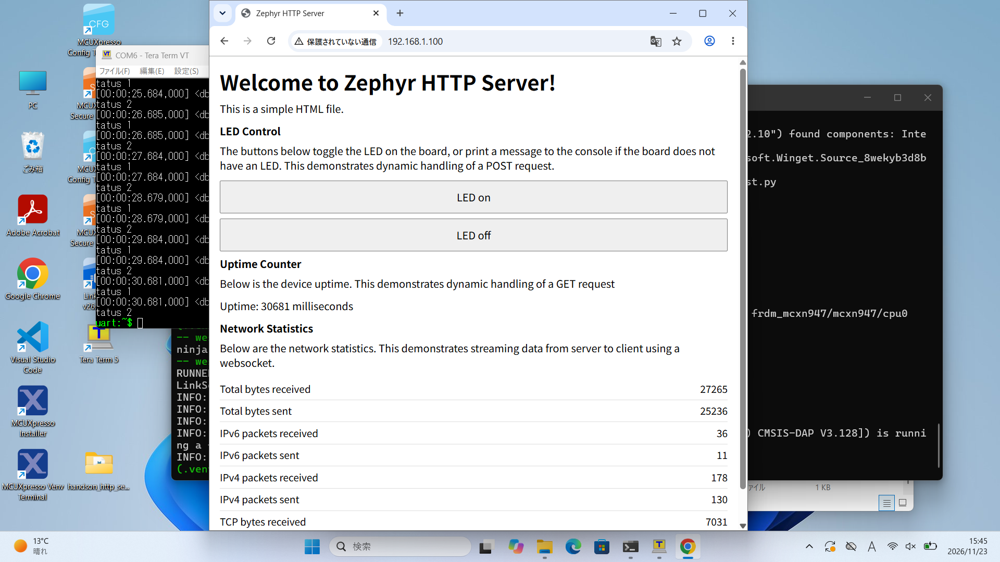

**図4.2-1** ブラウザで開いたLED制御ページ

このページには，「LED Control」のほかに，「Uptime Counter」（ボードの起動からの経過時間．4.3節で見る`/uptime`の値）と，「Network Statistics」（ボードが送受信したデータ量などの統計）も表示されます．

**✔ ここまでできればOK**
ページの「LED on」「LED off」ボタンで，ボード上のRGB LED（[図1.3-1](#1-3)の③）が**緑色に**点灯/消灯すれば成功です（図4.2-2）．2.3節のLチカでは同じRGB LEDが赤く点滅しましたが，今回は緑です．

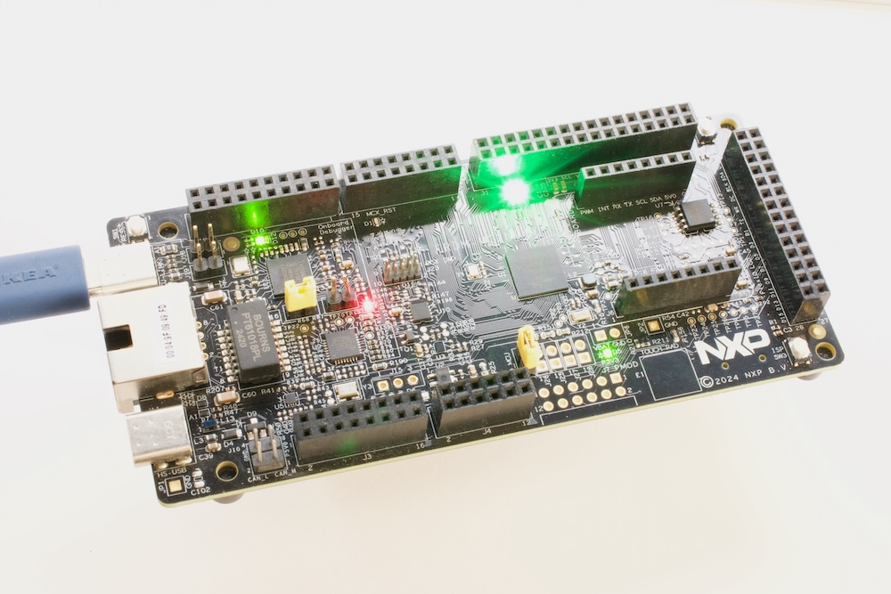

**図4.2-2** ブラウザの操作でRGB LEDが緑に光る

このとき，Tera Termには`[00:00:25.684,000] <dbg> ...`のような行が次々と流れ，`uart:~$`という表示も出ています．HTTP Serverサンプルが出しているログと，Zephyrのシェル（コマンド入力の受付）の表示で，異常ではありません．

**うまくいかないときは**
- pingは通るのにブラウザで表示されない → アドレスが`http://`になっているか確認します．会社のPCなどでプロキシが設定されている場合は，プロキシを経由しない設定が必要です（[A.6](#A-6)）．
- ページは表示されるがLEDが反応しない → 赤ではなく緑に光るので，色を確かめてください．それでも反応しなければ，ブラウザを再読み込み（`F5`）して，もう一度ボタンを押してみます．

> **コラム: ネットワーク機能の「重さ」について**
> 一般的な組み込み開発では，HTTPサーバーを1つ動かすだけでも，多くの下準備が必要になりがちです．TCP/IPスタック（lwIPなど）の組み込みと設定，ソケットAPIの用意，HTTPパーサーの選定と実装，静的ファイルの配信方法の実装，といった作業です．
>
> 今回は，それらがすべて`prj.conf`の`CONFIG_NET_*`・`CONFIG_HTTP_*`系のオプションを`y`にするだけで揃っています．アプリケーション側で書いたのは，各エンドポイントのハンドラ関数（リクエストが来たときに呼び出される関数）だけです．ネットワークスタックからHTTPサーバーまでを，1つのビルドシステムとKconfigで一貫して扱える．これが，Zephyrがマイコン向けRTOSでありながら，比較的大きなミドルウェア込みで語られる理由のひとつです．

> **コラム: ZephyrのTCP/IPスタックはlwIPなのか**
> 組み込み向けのTCP/IPスタックというと，lwIP（lightweight IP）を思い浮かべる方も多いかもしれません．しかしZephyrは，lwIPを外部から取り込むのではなく，`subsys/net/`以下に実装された独自のTCP/IPスタックを標準で使っています．IPv4/IPv6・TCP/UDP・ソケットAPIといった機能は，Zephyr本体に組み込まれています．
>
> `prj.conf`で有効にしている`CONFIG_NET_IPV4`や`CONFIG_NET_TCP`，`CONFIG_NET_SOCKETS`といったオプションも，このスタックの機能を指しています．（Zephyrは，モジュールとして外部のネットワークスタックを組み合わせる構成にも対応していますが，本記事で使っているのは標準のスタックです．）

<a id="4-3"></a>
### 4.3 /uptimeエンドポイントを覗いてみる

この節では，一番シンプルなエンドポイントの動きを確かめます．

**✔ ここまでできればOK**
ブラウザで`http://192.168.1.100/uptime`にアクセスすると，ボードの起動からの経過時間が表示されます．

この「GETリクエストに対して，値を計算してテキストで返す」というエンドポイントの作りを，次の5章でそのまま応用します．

> **解説: HTTPリクエストとレスポンス**
> 1. ブラウザで`/uptime`にアクセスすると，ブラウザからボードへ，「このパスの内容をください」という意味の`GET`リクエストが送られます．
> 2. ボード側では，リクエストを受け取ったHTTP Serverが，`/uptime`に紐づけられた**ハンドラ関数**（リクエストが来たときに呼び出される関数．ここでは`uptime_handler`）を呼び出します．
> 3. ハンドラは起動からの経過時間を計算し，その値をレスポンスの本文（body）としてセットします．
> 4. HTTP Serverは，この本文にステータス行（`200 OK`など）やヘッダーを付け加え，HTTPレスポンスとしてブラウザに返します．
> 5. ブラウザは，受け取ったレスポンスの本文を画面に表示します．
>
> 5章で追加する`/temperature`エンドポイントも，リクエストを受けて値を計算し，本文として返すという，まったく同じ流れで動いています．

---

<a id="chapter5"></a>
## 5. HTTP Serverを改変して，温度センサーの値をブラウザで見る

<a id="5-1"></a>
### 5.1 何を追加したか

この節では，4章のHTTP Serverサンプルに何を追加したのかを説明します．

4.3節で見た`/uptime`エンドポイントと同じ作りで，温度を返すエンドポイントを2つ追加しました．変更は`src/main.c`のごく一部です．

| エンドポイント | ハンドラ関数 | 返すもの |
|---|---|---|
| `/temperature` | `temperature_handler` | 温度を表示するHTMLページ |
| `/temperature.json` | `temperature_json_handler` | その時点の温度の数値だけ（JSON） |

ブラウザで開くのは`/temperature`のページです．このページには小さなJavaScriptが埋め込まれていて，1秒ごとに`/temperature.json`へ値を問い合わせ，表示を書き換えます（図5.1-1）．`/uptime`の値がトップページで自動的に更新されていくのと同じ仕組みです．

```c
static int temperature_handler(struct http_client_ctx *client, enum http_transaction_status status,
                const struct http_request_ctx *request_ctx,
                struct http_response_ctx *response_ctx, void *user_data)
{
    /* 3章の温度センサーと同じ sensor_sample_fetch_chan /
       sensor_channel_get の流れで気温を取得し，HTMLとして返す */
    ...
}

static int temperature_json_handler(struct http_client_ctx *client, enum http_transaction_status status,
                const struct http_request_ctx *request_ctx,
                struct http_response_ctx *response_ctx, void *user_data)
{
    /* 同じ方法で気温を取得し，数値だけを返す */
    ...
}
```

（抜粋）

追加したのは，次の2つだけです．他の部分（LED制御，`/uptime`，静的ページの配信）は，元のサンプルのまま変更していません．
- この2つのハンドラ関数（センサーの読み取り部分は，共通の関数にまとめています）
- それぞれを`/temperature`・`/temperature.json`というパスに紐づける，`HTTP_RESOURCE_DEFINE()`の2行

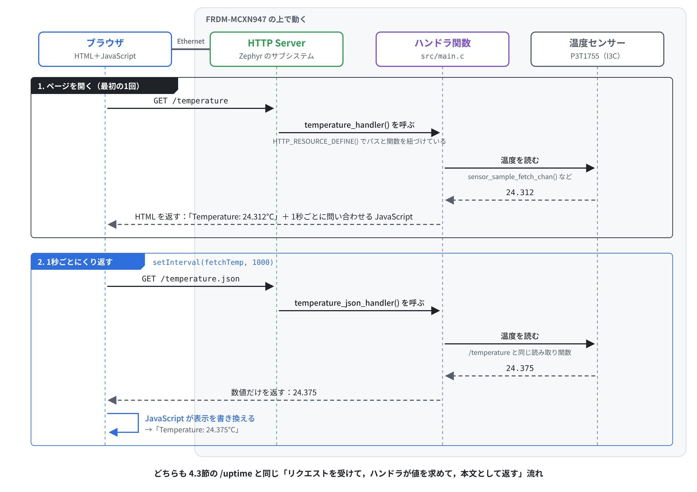

**図5.1-1** `/temperature`のページが温度を表示し，1秒ごとに更新する流れ

<a id="5-2"></a>
### 5.2 実際にブラウザで表示してみる

この節では，改変済みのコードを書き込み，ブラウザで温度を表示します．

改変済みのコードは，GitHubのリポジトリ[teddokano/handson_http_server_temp](https://github.com/teddokano/handson_http_server_temp)で公開しています．作業用フォルダにクローンして，これまでと同じ手順でビルド・書き込みします．

```powershell
# コマンド例5.2-1
cd ~\handson
git clone https://github.com/teddokano/handson_http_server_temp
cd handson_http_server_temp
```

【会場PCにはクローン済みにしておくか（会場でインターネット接続が使えるか）を確認．クローン済みの場合は`cd`以降だけを示す】

このリポジトリの`prj.conf`は，ボードのIPアドレスが4章と同じ`192.168.1.100`になるよう設定済みです．`prj.conf`を書き換える必要はありません．

```powershell
# コマンド例5.2-2
west build -p auto -b frdm_mcxn947//cpu0 .
```

ビルドが成功したら書き込みます．Ethernetケーブルは，4章でつないだままで構いません．

```powershell
# コマンド例5.2-3
west flash
```

**✔ ここまでできればOK**
書き込み後，数秒待ってから，ブラウザで`http://192.168.1.100/temperature`にアクセスすると，次のようなページが表示されます（図5.2-1）．

```text
Hello FRDM-MCXN947 temp sensor: P3T1755
Temperature: 24.312°C
← Back
```

温度の値は1秒ごとに自動で更新されます．温度センサー（[図1.3-1](#1-3)の④）を指で触って，値が上がっていくのを確かめてみてください．`http://192.168.1.100/temperature.json`を直接開くと，ページの裏で問い合わせている数値だけの応答（`24.312`のような値）も見られます．

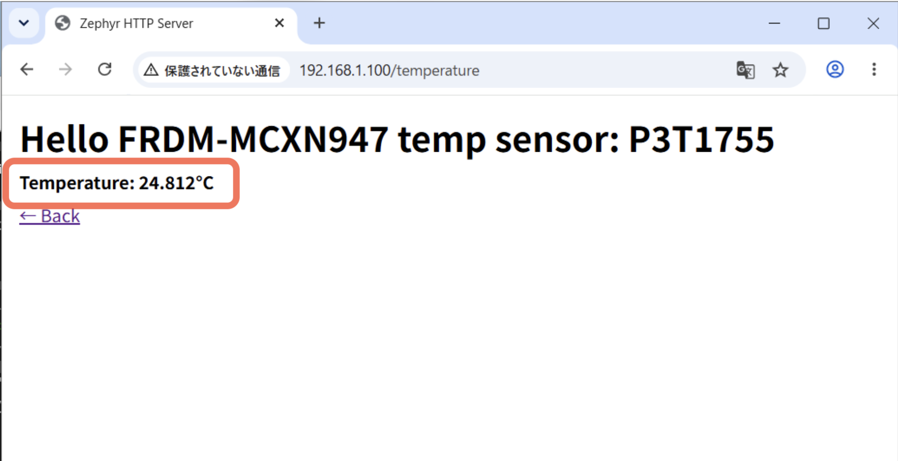

**図5.2-1** ブラウザに表示された温度

**うまくいかないときは**
- `git clone`で「already exists and is not an empty directory」と出る → すでにクローン済みです．そのまま`cd handson_http_server_temp`を実行して先に進んでください．
- `git clone`で「Could not resolve host」などと出る → PCがインターネットに接続されていません．Wi-Fiなど，インターネットに出られるネットワークに接続してから再実行してください．
- `/temperature`を開くと「404 Not Found」になる → 4章の元のサンプルが書き込まれたままになっています．プロンプトが`...\handson_http_server_temp>`になっているか確認し，コマンド例5.2-2からやり直してください．
- ページが開けない → 4.1節・4.2節の「うまくいかないときは」と同じ手順で確認します．

<a id="5-3"></a>
### 5.3 3章・4章の内容がどう組み合わさっているか

この章で作ったアプリケーションは，新しい仕組みを使っていません．2〜4章で1つずつ動かした部品を組み合わせただけです．どの部品をどこで見たのかを，表にまとめます．

| 5章で使っているもの | 5章のどこにあるか | どこで見たか |
|---|---|---|
| 温度センサーをエイリアスで取得する | `main.c`の`DEVICE_DT_GET(DT_ALIAS(ambient_temp0))` | 3.3節（thermometerと同じ1行） |
| 温度センサーをデバイスツリーに追加する | `boards/frdm_mcxn947_mcxn947_cpu0.overlay`の`p3t1755`ノード | 3.3節（thermometerと同じオーバーレイ） |
| センサーの機能を有効にする | `prj.conf`の`CONFIG_SENSOR=y` | 3.3節の図3.3-1 |
| 温度を読み取る | `sensor_sample_fetch_chan()`・`sensor_channel_get()` | 3章（thermometer） |
| パスとハンドラ関数を結び付ける | `HTTP_RESOURCE_DEFINE()`で`/temperature`・`/temperature.json`を登録 | 4.3節（`/uptime`と同じ書き方） |
| 値を計算してレスポンスで返す | `temperature_handler`・`temperature_json_handler` | 4.3節の解説（`uptime_handler`と同じ流れ） |
| ネットワークとHTTP Serverの機能 | `prj.conf`の`CONFIG_NET_*`・`CONFIG_HTTP_*` | 4章（元のサンプルのまま） |

それぞれ単体で動かした部品を組み合わせると，「ブラウザからセンサー値を見る」というアプリケーションになります．新しく書いたコードは，2つのハンドラ関数と，それを登録する2行だけです．

> **解説: main.cとCMakeLists.txtが少し煩雑に見える理由**
> `src/main.c`を開くと，`/temperature`のハンドラ以外にもかなりの行数があります．これは，HTTP Serverサンプルが，トップページのHTMLやJavaScript，LED制御・`/uptime`などの元からあるエンドポイントも，あわせて用意しているためです．これらは温度センサーの追加とは直接関係のない「HTTPサーバーとして動くための足回り」なので，今回は5.1節の2つのハンドラ関数だけに注目すれば十分です．足回りの仕組みは，[付録G](#appendixG)で説明しています．

<!-- CLAUDE: 
************************************ チェックとコメント追加はここまで 2026-08-18
-->

---

<a id="chapter6"></a>
## 6. まとめ

<a id="6-1"></a>
### 6.1 今日体験したこと

- Zephyrの開発環境（west・デバイスツリー・Kconfig）に触れた
- Lチカ，温度センサー読み取り，HTTP Serverをそれぞれ動かした
- 2つのサンプルを組み合わせて，ブラウザでセンサー値を見るアプリケーションを作った

<a id="6-2"></a>
### 6.2 自分でもう一度やってみるための情報源

- [Zephyr Project公式ドキュメント](https://docs.zephyrproject.org/latest/)
- [今回使ったサンプルコードのリポジトリ (teddokano/handson_http_server_temp)](https://github.com/teddokano/handson_http_server_temp)
- 【この記事自体へのリンクを挿入(公開後に確定)】

<a id="6-3"></a>
### 6.3 AIをどう活用できるか

Zephyrのサンプルコードを読んだり改変したりするとき，AIアシスタントに「このサンプルにこういう機能を足すには」と相談すると，既存コードのパターンに沿った改変案を出してもらえます．今回の`/temperature`エンドポイントも，既存の`/uptime`エンドポイントと同じ構造で追加しています．分からない箇所があれば，まず既存のサンプルコードの近い部分を探し，AIと一緒に読み解いてみることをおすすめします．

もう一つよくあるのが，`west build`でエラーになったときです．Zephyrのビルドでは，Kconfigの警告からCMakeのエラー，リンカのエラーまで，一度に大量のメッセージが出ます．どこが本当の原因なのか，初めは分かりにくいことがあります．

そんなときも，エラーメッセージ全体をそのままAIに貼り付けて，「これはどういうエラーですか」と聞いてみるところから始めるのがおすすめです．[付録G](#appendixG)で触れた`sections-rom.ld`まわりのリンクエラーも，この記事を書く過程で，AIと一緒に原因を特定したものです．

質問するときに伝えるとよい情報は，[0.4節](#0-4)の「質問するときは」にまとめています．AIに相談するときも同じです．

<a id="6-4"></a>
### 6.4 後片付け

**会場で参加された方**
ボードやケーブルは，抜かずにそのままにしておいてください．PCの片付けも不要です．会場スタッフの案内に従ってください．

**ご自身のPCで試した方**
- PowerShell（またはターミナル）は，そのまま閉じて構いません．仮想環境の有効化や`ZEPHYR_BASE`の設定は，ウィンドウを閉じれば消えます．閉じずに仮想環境だけを抜けたい場合は，`deactivate`を実行します．
- 4章でPCのEthernetを固定IPに設定した場合は，元に戻しておきましょう．[A.6](#A-6)のコラムと同じ画面で，「IP割り当て」を「自動（DHCP）」に戻します．戻さないと，そのEthernetポートを社内LANや自宅のルーターにつないだときに，インターネットにつながらなくなります．
- ボードには，最後に書き込んだプログラム（5章の温度表示つきHTTP Server）が残ります．電源を入れるたびにそのプログラムが動きますが，`west flash`でいつでも別のプログラムに書き換えられます．
- 作業用フォルダ`~\handson`は，残しておけば今日の続きをいつでも試せます．不要になったら，フォルダごと削除して構いません（`~\zephyrproject`は消さないでください）．

---

<a id="appendixA"></a>
## 付録A. うまくいかないときは

この付録では，コマンドをコピー＆ペーストして進める中でつまずきやすいポイントと，その回復方法をまとめています．本文の各節にある「うまくいかないときは」から参照しています．

<a id="A-1"></a>
### A.1 まず確認すること

エラーが出たら，原因を探す前に次の3点を確認してください．ほとんどのトラブルは，このどれかで見つかります．

1. **プロンプトの先頭に`(.venv)`が付いているか**
   付いていなければ，仮想環境が有効になっていません．PowerShellを開き直した，別のウィンドウで作業している，といった場合に起こります．コマンド例2.1-1を実行し直すか，会場PCでは`zinit <作業中のサンプル名>`（[コマンド例2.1-2](#2-1)）を実行します．
2. **今いるフォルダは正しいか**
   プロンプトの`PS C:\Users\<ユーザー名>\handson\thermometer>`のような部分が，今作業している節のサンプルのフォルダになっているか確認します．違っていたら，その節の最初のコマンド例にある`cd`を実行し直します．
3. **最初に出たエラーはどれか**
   エラーが出ると後続のメッセージが大量に出ます．画面を上にスクロールして，**最初に**赤字や`error`が出た行を探してください．複数行をまとめて貼り付けた場合は，どのコマンドで最初にエラーが出たかを確認します．

次のコマンドで，今の状態をまとめて確認できます．

```powershell
# コマンド例A.1-1
Get-Location
$env:ZEPHYR_BASE
west topdir
```

1行目に今いるフォルダ，2行目に`C:\Users\<ユーザー名>\zephyrproject\zephyr`，3行目に`C:/Users/<ユーザー名>/zephyrproject`が表示されれば，環境は正しく設定されています．2行目が空なら，コマンド例2.1-1を実行し直します．

<a id="A-2"></a>
### A.2 PowerShell・westまわり

| 症状 | 原因 | 回復方法 |
|---|---|---|
| `west : 用語 'west' は，コマンドレット，関数，スクリプト ファイル，または操作可能なプログラムの名前として認識されません` | 仮想環境が有効になっていない | `zinit <作業中のサンプル名>`を実行する（`zinit`がないPCでは，コマンド例2.1-1を実行し，作業中のフォルダに`cd`で戻る） |
| `west: unknown command "build"` | `ZEPHYR_BASE`が設定されていない（westがワークスペースを見つけられない） | `zinit <作業中のサンプル名>`を実行する（`zinit`がないPCでは，コマンド例2.1-1を実行し，作業中のフォルダに`cd`で戻る） |
| `Activate.ps1`で「このシステムではスクリプトの実行が無効になっている」 | PowerShellの実行ポリシー | `Set-ExecutionPolicy -Scope CurrentUser RemoteSigned`を実行してから，コマンド例2.1-1をやり直す |
| `cd`や`Copy-Item`で「パスが存在しないため検出できません」 | パスの打ち間違い，またはコピー元・コピー先のフォルダが無い | コマンドを手で打たずにコピーし直す．`~\handson`が無い場合はコマンド例2.2-1の1行目を実行する |
| コマンドを貼り付けたのに何も起きず，プロンプトの後ろにコマンドが残っている | 最後の行の改行がコピーされていない | `Enter`を押す |
| 貼り付けたら`>>`というプロンプトが出て止まった | `"`の閉じ忘れなど，コマンドが途中で切れている | `Ctrl`+`C`で中断し，コマンドを丸ごとコピーし直す |
| `ping`や`west`の結果ではなく，日本語の文章がエラーになっている | 記事の本文や`prj.conf`の中身まで貼り付けてしまった | コードブロックの中だけをコピーし直す．PowerShell上で実行されただけなので，ファイルなどへの影響はない |

<a id="A-3"></a>
### A.3 ビルドのエラー

| 症状 | 原因 | 回復方法 |
|---|---|---|
| `Invalid BOARD`，`No board named ...` | `-b`のボード名の打ち間違い | コマンド例をコピーし直す．`frdm_mcxn947//cpu0`の`//`も含めて正確に |
| `source directory ... does not contain a CMakeLists.txt`など | サンプルのフォルダ以外（`~\handson`や`~\zephyrproject`など）でビルドした | その節のコマンド例の`cd`を実行してからビルドし直す |
| `Build directory ... is for application ...`のように，別のアプリのビルドフォルダだと言われる | 以前のビルドの`build`フォルダが残っている | `-p auto`を`-p always`に変えてビルドし直す（下記） |
| 設定を変えたのに反映されない，原因不明のエラーが続く | ビルドフォルダに古い情報が残っている | `-p always`でクリーンビルドする（下記） |
| `prj.conf`を書き換えた後にKconfigのエラーが出る | 書き換えの際に`"`や`=`を消してしまった | `prj.conf`を見直す．分からなくなったら[A.7](#A-7)の手順でサンプルをコピーし直す |

クリーンビルドは次のコマンドで行います．ビルドフォルダを消して最初から作り直すので，時間はかかりますが確実です．

```powershell
# コマンド例A.3-1
west build -p always -b frdm_mcxn947//cpu0 .
```

エラーメッセージが長すぎて画面で追えない場合は，次のようにしてファイルに保存できます．保存した`build_log.txt`をVSCodeで開いて`error`で検索したり，内容をAIに貼り付けて相談したりするのに便利です．

```powershell
# コマンド例A.3-2
west build -p auto -b frdm_mcxn947//cpu0 . 2>&1 | Out-File build_log.txt
code build_log.txt
```

**ビルドが遅いとき（ご自身のPCで試している場合）**

WindowsでのZephyrのビルドは，同じPCのLinuxより遅くなりがちです．http_serverのような大きめのサンプルでは，1回のビルドに数分かかることもあります．次の3つで大きく改善します（会場PCは設定済みです）．

- **ccacheを入れる**: 一度コンパイルした結果を覚えておき，同じものを2回目以降は再利用するツールです．インストールしておけば，Zephyrが自動で使います．同じサンプルを同じフォルダでビルドし直すときは，`-p always`でクリーンビルドした場合も含めて，コンパイルの大部分が省略されて速くなります（最初の1回は通常どおり時間がかかります）．筆者の環境では，http_serverのクリーンビルドが約4分半から73秒になりました．
- **Windows Defenderの除外設定**: 「Windows セキュリティ」→「ウイルスと脅威の防止」→「設定の管理」→「除外」を開きます．`~\zephyrproject`・作業用フォルダ・Zephyr SDKのフォルダ・ccacheのキャッシュフォルダ（通常は`%LOCALAPPDATA%\ccache`）を，除外に追加します．Defender以外のウイルス対策ソフトを使っている場合は，そのソフトの設定で除外します．ビルドのたびに大量のファイルがスキャンされるのを防げます．会社のPCでは，情報システム部門の方針を確認してください．
- **電源設定**: ノートPCはACアダプタをつなぎ，電源モードを「最適なパフォーマンス」にします．

```powershell
# コマンド例A.3-3
winget install --id Ccache.Ccache -e
```

インストールしたらPowerShellを開き直し，`zinit`（またはコマンド例2.1-1）で環境を設定してから，`-p always`でビルドし直してください．ccacheを入れる前に作ったbuildフォルダは，ccacheを使わない設定のままになっているためです．

> **ご自身のPCで試している場合**
> Windowsのユーザー名に日本語やスペースが含まれていると，環境によってはビルドツールがパスを正しく扱えずにエラーになることがあります．その場合は，`~\handson`の代わりに`C:\handson`のような英数字だけの短いパスを作業用フォルダにしてみてください．

<a id="A-4"></a>
### A.4 書き込み（west flash）のエラー

| 症状 | 原因 | 回復方法 |
|---|---|---|
| `No probe found`など，デバッグプローブが見つからないというエラー | USBケーブルがボードのデバッグ用コネクタ（MCU-Link側）に挿さっていない．または充電専用のUSBケーブルを使っている | 挿すコネクタを確認し，抜き差ししてから再実行．データ通信対応のケーブルを使う |
| プローブが使用中，接続できないというエラー | MCUXpresso for VSCなど，別のツールでデバッグ中 | 他のツールのデバッグセッションを終了してから再実行 |
| `west flash`がビルドからやり直そうとしてエラーになる | 直前のビルドが失敗している | `west flash`ではなく，ビルドのエラーを先に解決する（[A.3](#A-3)） |
| 書き込みが途中で止まった，ボードが反応しない | 一時的な通信エラー | USBケーブルを抜いて数秒待ってから挿し直し，`west flash`を再実行 |

`west flash`は何度実行しても問題ありません．失敗したら，原因を直してから同じコマンドを再実行してください．

<a id="A-5"></a>
### A.5 シリアルコンソールに何も出ない

| 症状 | 原因 | 回復方法 |
|---|---|---|
| Tera Termの「新しい接続」で「シリアル」が選べない，ボードのポートが出てこない | USBケーブルが挿さっていない，または充電専用ケーブル | ケーブルを確認してから，「ファイル」→「新しい接続」で画面を開き直す（開き直すとポート一覧が更新される） |
| 「ポートが使用中」「シリアルポートを開けません」で接続できない | 別のウィンドウのTera Termや，VSCodeのシリアルモニターなどが同じポートを開いている | 他のウィンドウ・アプリでの接続を閉じてから接続し直す |
| 全体が意味のない記号の羅列になる | ボーレートが違う | 「設定」→「シリアルポート」で115200に設定し直す |
| 接続しているのに何も出ない | 出力のタイミングを逃した | ボードのRESETボタンを押す |
| USBケーブルを抜き差ししたら表示が止まった | 抜き差しでTera Termの接続が切れた | 「ファイル」→「接続断」のあと，「ファイル」→「新しい接続」でポートを選び直す．COM番号が変わっていることがあるので注意 |
| `°`などの記号が文字化けする | 受信の文字コードがUTF-8になっていない | [2.2節](#2-2)のTera Termの手順4のとおり，受信の文字コードを`UTF-8`にする |

<a id="A-6"></a>
### A.6 ネットワーク・ブラウザまわり

PC側のIPアドレスは，PowerShellで次のコマンドを実行して確認できます．

```powershell
# コマンド例A.6-1
ipconfig
```

「イーサネット アダプター」の欄の「IPv4 アドレス」を確認してください．

| 症状 | 原因 | 回復方法 |
|---|---|---|
| IPv4アドレスが`169.254.x.x`になっている | PCのEthernetが固定IPに設定されていない | PC側を`192.168.1.10`／`255.255.255.0`などに設定する（下記） |
| IPv4アドレスが`192.168.1.100`になっている | PCとボードのIPアドレスが重複している | PC側を`192.168.1.100`以外（例: `192.168.1.10`）にする |
| PCのWi-Fiも`192.168.1.x`のネットワークにつながっている | 通信がWi-Fi側に流れてしまい，ボードに届かない | 実習の間だけWi-Fiを切断する |
| pingは通るが，ブラウザで開けない | `https://`で接続しようとしている，またはプロキシ経由になっている | アドレスを`http://192.168.1.100/`と入力し直す．プロキシを使っている場合は，`192.168.1.100`をプロキシの例外に追加する |
| `prj.conf`を直したのにIPアドレスが変わらない | 保存していない，またはビルドし直していない | VSCodeで`Ctrl`+`S`で保存し，コマンド例4.1-3からやり直す |

> **ご自身のPCで試している場合: PC側の固定IPの設定**
> Windowsの「設定」→「ネットワークとインターネット」→「イーサネット」を開き，「IP割り当て」の「編集」から「手動」を選びます．IPv4をオンにして，IPアドレスに`192.168.1.10`，サブネットマスクに`255.255.255.0`を入力して保存します（ゲートウェイは空欄で構いません）．詳しくは4章の冒頭で紹介したHTTP Serverのブログ記事も参照してください．
> 
> 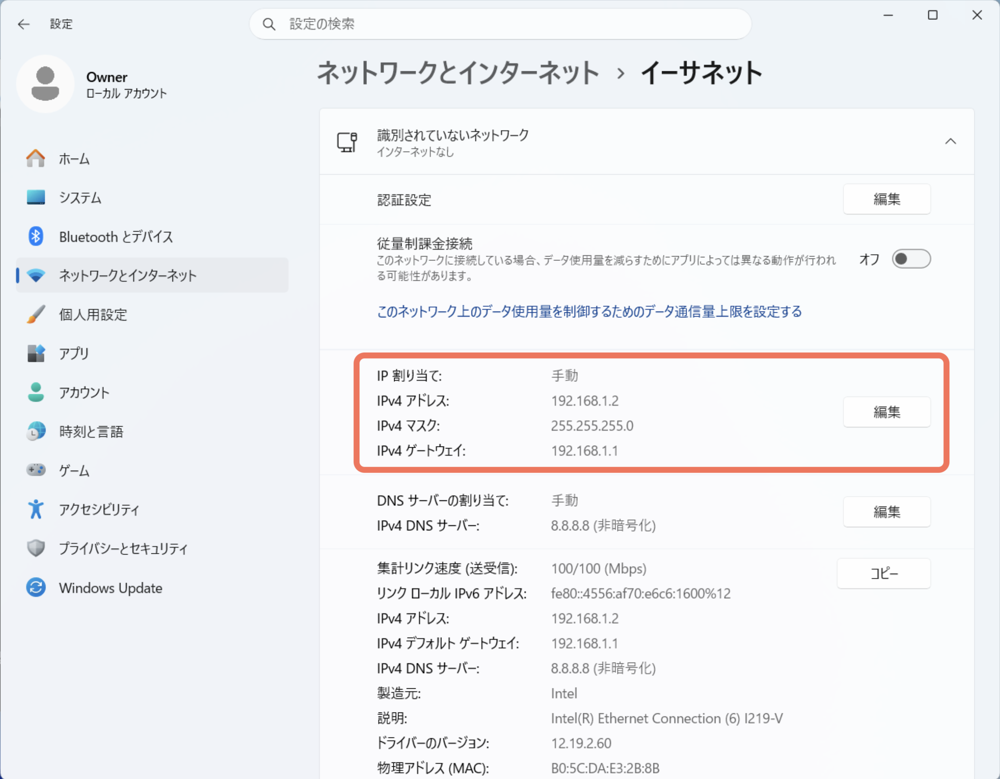
>
> **図A.6-1** Windowsの「設定」でEthernetを固定IPにする画面


<a id="A-7"></a>
### A.7 どうしても直らないときのリセット手順

何が原因か分からなくなったときは，その節を最初からやり直すのが一番の近道です．作業用フォルダにコピーしたサンプルを消しても，`~\zephyrproject`の中の元のサンプルは残っているので，何度でもやり直せます．

1. PowerShellのウィンドウを閉じて，新しく開きます．
2. コマンド例2.1-1（会場PCでは`zinit`）を実行し，環境を設定し直します．
3. やり直したい節のサンプルのフォルダを削除します．たとえば4章をやり直す場合は次のようにします．

   ```powershell
   # コマンド例A.7-1
   cd ~\handson
   Remove-Item -Recurse -Force ~\handson\http_server
   ```

   フォルダ名の部分（`http_server`）は，やり直す節に合わせて`hello_world`・`blinky`・`thermometer`・`handson_http_server_temp`に読み替えてください．`~\handson`や`~\zephyrproject`そのものを消さないよう注意してください．
4. その節の最初のコマンド例（コピーと`cd`）からやり直します．

ボードの動作がおかしいときは，USBケーブルとEthernetケーブルを両方抜いて数秒待ち，挿し直してから`west flash`をやり直してください．

---

<a id="appendixB"></a>
## 付録B. コマンド例一覧（PowerShell／bash・zsh）

本文に登場するコマンド例を，番号順にまとめました．本文はWindowsのPowerShellを前提にしていますが，ご自身のmacOSやLinuxの環境で試す方のために，bash・zsh用の書き方もあわせて載せています．環境構築は，[2.1節](#2-1)の「ご自身のPCで試す場合: 環境のセットアップ」で紹介した公式のGetting Started Guideの手順どおりに`~/zephyrproject`へ済ませてある前提です．

> **bash・zshで試す場合の注意**
> - **パスの区切り**: PowerShellの`\`は，bash・zshでは`/`になります．`~`がホームフォルダを表すのは共通です．
> - **コマンド例の番号の行は付けていません**: macOS標準のzshは，初期設定では対話中に入力した`#`をコメントとして扱いません．そのため`# コマンド例2.1-1`の行を貼り付けると「command not found: #」というエラーになります．bash・zsh版のコードブロックには番号の行を入れず，見出しで番号を示しています．
> - **仮想環境と`ZEPHYR_BASE`**: どちらもそのターミナルの中だけで有効なのは，PowerShellと同じです．ターミナルを開き直したら，コマンド例2.1-1から実行し直します．
> - **シリアルポートの名前**: macOSでは`/dev/tty.usbmodemXXXX`，Linuxでは`/dev/ttyACM0`などになります（[2.2節](#2-2)）．

**PowerShellとbash・zshの書き方の違い**

PowerShellとbash・zshで書き方が違うところだけを，対にしてまとめました．`cd`や`west build`・`west flash`・`git clone`のように，両方で同じ書き方のものは載せていません．

| やること | PowerShell | bash・zsh | 出てくるコマンド例 |
|---|---|---|---|
| パスの区切り | `~\handson` | `~/handson` | 全体 |
| 仮想環境の有効化 | `.\.venv\Scripts\Activate.ps1` | `source .venv/bin/activate` | 2.1-1 |
| `ZEPHYR_BASE`の設定 | `$env:ZEPHYR_BASE = "..."` | `source zephyr/zephyr-env.sh` | 2.1-1 |
| 設定ファイル（プロファイル）を開く | `notepad $PROFILE.CurrentUserAllHosts` | `code ~/.bashrc`／`code ~/.zshrc` | 2.1-3 |
| フォルダを作る | `New-Item -ItemType Directory -Force` | `mkdir -p` | 2.2-1 |
| フォルダごとコピーする | `Copy-Item -Recurse` | `cp -r` | 2.2-1，2.3-1，3.1-1，4.1-1 |
| `ping`を4回で止める | `ping`（初めから4回で止まる） | `ping -c 4` | 4.1-5 |
| 今いるフォルダを表示する | `Get-Location` | `pwd` | A.1-1 |
| 環境変数を表示する | `$env:ZEPHYR_BASE` | `echo $ZEPHYR_BASE` | A.1-1 |
| ログをファイルに保存する | `2>&1 \| Out-File build_log.txt` | `> build_log.txt 2>&1` | A.3-2 |
| ccacheをインストールする | `winget install --id Ccache.Ccache -e` | `brew install ccache`（macOS）／`sudo apt install ccache`（Ubuntu） | A.3-3 |
| PCのIPアドレスを確認する | `ipconfig` | `ifconfig`（macOS）／`ip addr`（Linux） | A.6-1 |
| フォルダを消す | `Remove-Item -Recurse -Force` | `rm -rf` | A.7-1 |

<a id="B-2"></a>
### 2章 開発環境を触ってみる

#### コマンド例2.1-1 環境の準備と確認（[2.1節](#2-1)）

```powershell
# コマンド例2.1-1
cd ~\zephyrproject
.\.venv\Scripts\Activate.ps1
$env:ZEPHYR_BASE = "$HOME\zephyrproject\zephyr"
west --version
west topdir
```

```bash
cd ~/zephyrproject
source .venv/bin/activate
source zephyr/zephyr-env.sh
west --version
west topdir
```

bash・zshでは，`zephyr-env.sh`が`ZEPHYR_BASE`を設定してくれます．`export ZEPHYR_BASE=~/zephyrproject/zephyr`と直接書いても同じです．

#### コマンド例2.1-2 環境の準備と作業用フォルダへの移動をまとめて行う（[2.1節](#2-1)）

```powershell
# コマンド例2.1-2
zinit thermometer
```

```bash
zinit thermometer
```

bash・zshで`zinit`を使うには，コマンド例2.1-3で開いたファイルに，次の関数を書き加えて保存し，ターミナルを開き直します（ファイルに書く内容です．ターミナルに貼り付けるコマンドではありません）．

```
zinit() {
  cd ~/zephyrproject || return
  source .venv/bin/activate
  source zephyr/zephyr-env.sh
  west --version
  west topdir
  if [ -n "$1" ]; then cd ~/handson/"$1"; fi
}
```

#### コマンド例2.1-3 プロファイル（シェルの設定ファイル）を開く（[2.1節](#2-1)）

```powershell
# コマンド例2.1-3
if (-not (Test-Path $PROFILE.CurrentUserAllHosts)) { New-Item -Force $PROFILE.CurrentUserAllHosts | Out-Null }
notepad $PROFILE.CurrentUserAllHosts
```

bashの場合:

```bash
code ~/.bashrc
```

zsh（macOSの標準）の場合:

```bash
code ~/.zshrc
```

#### コマンド例2.2-1 hello_worldを作業用フォルダにコピー（[2.2節](#2-2)）

```powershell
# コマンド例2.2-1
New-Item -ItemType Directory -Force ~\handson | Out-Null
Copy-Item -Recurse ~\zephyrproject\zephyr\samples\hello_world ~\handson\hello_world
cd ~\handson\hello_world
```

```bash
mkdir -p ~/handson
cp -r ~/zephyrproject/zephyr/samples/hello_world ~/handson/hello_world
cd ~/handson/hello_world
```

`cp -r`も`Copy-Item`と同じく，コピー先のフォルダがすでにあると，その中に入れ子でコピーします．

#### コマンド例2.2-2 hello_worldのビルド（[2.2節](#2-2)）

```powershell
# コマンド例2.2-2
west build -p auto -b frdm_mcxn947/mcxn947/cpu0 .
```

```bash
west build -p auto -b frdm_mcxn947/mcxn947/cpu0 .
```

#### コマンド例2.2-3 hello_worldの書き込み（[2.2節](#2-2)）

```powershell
# コマンド例2.2-3
west flash
```

```bash
west flash
```

Linuxでは，USBデバイスへのアクセス権の設定（udevルール）がないと，書き込みツールがデバッグプローブを見つけられないことがあります．その場合は，書き込みツール（LinkServerなど）のインストール手順にあるudevルールの設定を行ってください．

#### コマンド例2.3-1 blinkyを作業用フォルダにコピー（[2.3節](#2-3)）

```powershell
# コマンド例2.3-1
Copy-Item -Recurse ~\zephyrproject\zephyr\samples\basic\blinky ~\handson\blinky
cd ~\handson\blinky
```

```bash
cp -r ~/zephyrproject/zephyr/samples/basic/blinky ~/handson/blinky
cd ~/handson/blinky
```

#### コマンド例2.3-2 blinkyのビルド（[2.3節](#2-3)）

```powershell
# コマンド例2.3-2
west build -p auto -b frdm_mcxn947//cpu0 .
```

```bash
west build -p auto -b frdm_mcxn947//cpu0 .
```

#### コマンド例2.3-3 blinkyの書き込み（[2.3節](#2-3)）

```powershell
# コマンド例2.3-3
west flash
```

```bash
west flash
```

<a id="B-3"></a>
### 3章 温度センサーを動かしてみる

#### コマンド例3.1-1 thermometerを作業用フォルダにコピー（[3.1節](#3-1)）

```powershell
# コマンド例3.1-1
Copy-Item -Recurse ~\zephyrproject\zephyr\samples\sensor\thermometer ~\handson\thermometer
cd ~\handson\thermometer
```

```bash
cp -r ~/zephyrproject/zephyr/samples/sensor/thermometer ~/handson/thermometer
cd ~/handson/thermometer
```

#### コマンド例3.1-2 thermometerのビルド（[3.1節](#3-1)）

```powershell
# コマンド例3.1-2
west build -p auto -b frdm_mcxn947//cpu0 .
```

```bash
west build -p auto -b frdm_mcxn947//cpu0 .
```

#### コマンド例3.1-3 thermometerの書き込み（[3.1節](#3-1)）

```powershell
# コマンド例3.1-3
west flash
```

```bash
west flash
```

<a id="B-4"></a>
### 4章 HTTP Serverを動かしてみる

#### コマンド例4.1-1 http_serverを作業用フォルダにコピー（[4.1節](#4-1)）

```powershell
# コマンド例4.1-1
Copy-Item -Recurse ~\zephyrproject\zephyr\samples\net\sockets\http_server ~\handson\http_server
cd ~\handson\http_server
```

```bash
cp -r ~/zephyrproject/zephyr/samples/net/sockets/http_server ~/handson/http_server
cd ~/handson/http_server
```

#### コマンド例4.1-2 prj.confをVSCodeで開く（[4.1節](#4-1)）

```powershell
# コマンド例4.1-2
code prj.conf
```

```bash
code prj.conf
```

macOSで`code`が「command not found」になる場合は，VSCodeでコマンドパレット（`Cmd`+`Shift`+`P`）を開き，「Shell Command: Install 'code' command in PATH」を実行してから，ターミナルを開き直してください．

#### コマンド例4.1-3 http_serverのビルド（[4.1節](#4-1)）

```powershell
# コマンド例4.1-3
west build -p auto -b frdm_mcxn947//cpu0 .
```

```bash
west build -p auto -b frdm_mcxn947//cpu0 .
```

#### コマンド例4.1-4 http_serverの書き込み（[4.1節](#4-1)）

```powershell
# コマンド例4.1-4
west flash
```

```bash
west flash
```

#### コマンド例4.1-5 ボードとの疎通確認（[4.1節](#4-1)）

```powershell
# コマンド例4.1-5
ping 192.168.1.100
```

```bash
ping -c 4 192.168.1.100
```

macOS・Linuxの`ping`は，WindowsとちがってCtrl+Cで止めるまで送り続けます．`-c 4`は「4回送ったら終わる」という指定です．応答は`64 bytes from 192.168.1.100: ...`のように表示されます．

<a id="B-5"></a>
### 5章 HTTP Serverを改変して，温度センサーの値をブラウザで見る

#### コマンド例5.2-1 改変版のリポジトリを取得（[5.2節](#5-2)）

```powershell
# コマンド例5.2-1
cd ~\handson
git clone https://github.com/teddokano/handson_http_server_temp
cd handson_http_server_temp
```

```bash
cd ~/handson
git clone https://github.com/teddokano/handson_http_server_temp
cd handson_http_server_temp
```

#### コマンド例5.2-2 改変版のビルド（[5.2節](#5-2)）

```powershell
# コマンド例5.2-2
west build -p auto -b frdm_mcxn947//cpu0 .
```

```bash
west build -p auto -b frdm_mcxn947//cpu0 .
```

#### コマンド例5.2-3 改変版の書き込み（[5.2節](#5-2)）

```powershell
# コマンド例5.2-3
west flash
```

```bash
west flash
```

<a id="B-A"></a>
### 付録A うまくいかないときは

#### コマンド例A.1-1 今の状態をまとめて確認（[A.1](#A-1)）

```powershell
# コマンド例A.1-1
Get-Location
$env:ZEPHYR_BASE
west topdir
```

```bash
pwd
echo $ZEPHYR_BASE
west topdir
```

#### コマンド例A.3-1 クリーンビルド（[A.3](#A-3)）

```powershell
# コマンド例A.3-1
west build -p always -b frdm_mcxn947//cpu0 .
```

```bash
west build -p always -b frdm_mcxn947//cpu0 .
```

#### コマンド例A.3-2 ビルドのログをファイルに保存（[A.3](#A-3)）

```powershell
# コマンド例A.3-2
west build -p auto -b frdm_mcxn947//cpu0 . 2>&1 | Out-File build_log.txt
code build_log.txt
```

```bash
west build -p auto -b frdm_mcxn947//cpu0 . > build_log.txt 2>&1
code build_log.txt
```

#### コマンド例A.3-3 ccacheのインストール（[A.3](#A-3)）

```powershell
# コマンド例A.3-3
winget install --id Ccache.Ccache -e
```

macOS（Homebrew）の場合:

```bash
brew install ccache
```

Linux（Ubuntu）の場合:

```bash
sudo apt install ccache
```

#### コマンド例A.6-1 PC側のIPアドレスを確認（[A.6](#A-6)）

```powershell
# コマンド例A.6-1
ipconfig
```

macOSの場合:

```bash
ifconfig
```

Linuxの場合:

```bash
ip addr
```

macOSでは`en0`などのインターフェースの`inet`の行に，Linuxでは`eth0`や`enp...`などの`inet`の行に，IPv4アドレスが表示されます．

#### コマンド例A.7-1 作業用のサンプルを削除してやり直す（[A.7](#A-7)）

```powershell
# コマンド例A.7-1
cd ~\handson
Remove-Item -Recurse -Force ~\handson\http_server
```

```bash
cd ~/handson
rm -rf ~/handson/http_server
```

`rm -rf`は確認なしで削除し，ごみ箱にも残りません．フォルダ名を打ち間違えると別のフォルダが消えてしまうので，`~/handson`や`~/zephyrproject`そのものを指定していないことを確認してから実行してください．

<a id="B-C"></a>
### 付録C やってみよう

#### コマンド例C.1-1 blinkyのmain.cを開く（[C.1](#C-1)）

```powershell
# コマンド例C.1-1
cd ~\handson\blinky
code src\main.c
```

```bash
cd ~/handson/blinky
code src/main.c
```

#### コマンド例C.2-1 hello_worldのmain.cを開く（[C.2](#C-2)）

```powershell
# コマンド例C.2-1
cd ~\handson\hello_world
code src\main.c
```

```bash
cd ~/handson/hello_world
code src/main.c
```

#### コマンド例C.3-1 thermometerのmain.cを開く（[C.3](#C-3)）

```powershell
# コマンド例C.3-1
cd ~\handson\thermometer
code src\main.c
```

```bash
cd ~/handson/thermometer
code src/main.c
```

#### コマンド例C.4-1 改変版HTTP Serverのmain.cを開く（[C.4](#C-4)）

```powershell
# コマンド例C.4-1
cd ~\handson\handson_http_server_temp
code src\main.c
```

```bash
cd ~/handson/handson_http_server_temp
code src/main.c
```

#### コマンド例C.4-2 改変版のmain.cを元に戻す（[C.4](#C-4)）

```powershell
# コマンド例C.4-2
git checkout -- src/main.c
```

```bash
git checkout -- src/main.c
```

#### コマンド例D.1-1 Zephyrが対応しているFRDM-MCXボードの一覧を表示（[D.1](#D-1)）

```powershell
# コマンド例D.1-1
west boards -n frdm_mcx
```

```bash
west boards -n frdm_mcx
```

---

<a id="appendixC"></a>
## 付録C. やってみよう（早く終わった方へ）

本文の手順が早く終わった方や，帰ってから少し遊んでみたい方向けの課題です．どれもサンプルコードを数行書き換えるだけで試せます．書き換えたら，必ずVSCodeで`Ctrl`+`S`を押して保存してから，ビルドと書き込みをしてください．

書き換えたコードが分からなくなったときは，[A.7](#A-7)の手順でサンプルをコピーし直せば，いつでも元に戻せます．

<a id="C-1"></a>
### C.1 Lチカの点滅間隔を変える

2.3節で動かした`blinky`の点滅を速くしてみましょう．

```powershell
# コマンド例C.1-1
cd ~\handson\blinky
code src\main.c
```

`main.c`の中の次の行を探します．

```c
#define SLEEP_TIME_MS   1000
```

`1000`は「1000ミリ秒＝1秒ごとにLEDを切り替える」という意味です．これを`200`などに書き換えて保存し，[コマンド例2.3-2](#2-3)でビルド，[コマンド例2.3-3](#2-3)で書き込みます．点滅が速くなれば成功です．

<a id="C-2"></a>
### C.2 Hello Worldのメッセージを変える

```powershell
# コマンド例C.2-1
cd ~\handson\hello_world
code src\main.c
```

`printf("Hello World! %s\n", CONFIG_BOARD_TARGET);`の`Hello World!`の部分を，好きな文字列に書き換えてみましょう．保存したら，Tera Termを接続した状態で[コマンド例2.2-2](#2-2)でビルド，[コマンド例2.2-3](#2-2)で書き込みます．

日本語の文字列も表示できます．2.2節のTera Termの手順4でTera Termの受信の文字コードを`UTF-8`にしていれば，正しく表示されます．文字化けする場合は，その設定を確認してください．

<a id="C-3"></a>
### C.3 温度を華氏でも表示する

3章の`thermometer`で，摂氏（°C）に加えて華氏（°F）も表示してみましょう．

```powershell
# コマンド例C.3-1
cd ~\handson\thermometer
code src\main.c
```

`main()`の最後のほうにある，次の行を探します．

```c
		printf("Temperature is %0.1lf°C\n", sensor_value_to_double(&value));
```

**ヒント**: 華氏は「摂氏 × 9 ÷ 5 ＋ 32」で計算できます．

**答えの例**: 上の1行を，次の2行に置き換えます．

```c
		double c = sensor_value_to_double(&value);
		printf("Temperature is %0.1lf°C (%0.1lf°F)\n", c, c * 9.0 / 5.0 + 32.0);
```

保存したら，[コマンド例3.1-2](#3-1)でビルド，[コマンド例3.1-3](#3-1)で書き込みます．`Temperature is 24.3°C (75.7°F)`のように表示されれば成功です．

<a id="C-4"></a>
### C.4 ブラウザに表示する温度の桁数を変える

5章の改変版HTTP Serverでは，温度を小数点以下3桁で表示しています．これを1桁にしてみましょう．

```powershell
# コマンド例C.4-1
cd ~\handson\handson_http_server_temp
code src\main.c
```

**ヒント**: 画面の表示に関わっているのは，`main.c`の中の次の2か所です．VSCodeの検索（`Ctrl`+`F`）で探してみてください．

- `temperature_handler`の中の，ページを最初に表示するときの書式: `"Temperature: %.3f&deg;C"`
- 1秒ごとに表示を書き換えるJavaScriptの中: `t.toFixed(3)`

`%.3f`で検索すると，`temperature_json_handler`の中にももう1か所見つかります．こちらはブラウザに数値を渡すためのものなので，今回は変えなくて構いません．

**答えの例**: 上の2か所を，それぞれ`"Temperature: %.1f&deg;C"`と`t.toFixed(1)`に書き換えます．保存したら，[コマンド例5.2-2](#5-2)でビルド，[コマンド例5.2-3](#5-2)で書き込み，ブラウザで`http://192.168.1.100/temperature`を開き直します．

片方だけ書き換えると，ページを開いた直後だけ3桁で，1秒後から1桁になる（またはその逆）という動きになります．HTMLを返すC言語側と，ブラウザで動くJavaScript側の両方が表示に関わっていることが分かります．

このフォルダはGitで取得したものなので，次のコマンドで書き換える前の状態に戻せます．

```powershell
# コマンド例C.4-2
git checkout -- src/main.c
```

---

<a id="appendixD"></a>
## 付録D. 他のFRDMボードで試すには

本記事はFRDM-MCXN947を前提にしていますが，ZephyrはNXPの他のFRDMボードにも対応しています．手元に別のボードがある場合のヒントをまとめます．

<a id="D-1"></a>
### D.1 ボード名を調べる

`west build`の`-b`に指定するボード名は，次のコマンドで一覧できます．

```powershell
# コマンド例D.1-1
west boards -n frdm_mcx
```

主なボードの指定方法は次のとおりです．

| ボード | `-b`に指定する名前 |
|---|---|
| FRDM-MCXN947 | `frdm_mcxn947//cpu0`（本記事） |
| FRDM-MCXN236 | `frdm_mcxn236` |
| FRDM-MCXA153 | `frdm_mcxa153` |
| FRDM-MCXA156 | `frdm_mcxa156` |
| FRDM-MCXC444 | `frdm_mcxc444` |

FRDM-MCXN947のようなデュアルコアのボード以外は，ボード名だけで指定できます（[2.2節](#2-2)の解説）．

【この表のボード名を，会場PCのZephyrバージョンで確認】

<a id="D-2"></a>
### D.2 サンプルごとの注意

- **hello_world**: ほぼすべてのボードでそのまま動きます．シリアルポートの名前やボーレートはボードによって異なることがあるので，各ボードのドキュメントを確認してください．
- **blinky**: ボードのデバイスツリーに`led0`というエイリアスが定義されていれば，そのまま動きます（[2.4節](#2-4)）．
- **thermometer**: 温度センサーがボードに載っていて，そのセンサーを`ambient-temp0`として指すオーバーレイが必要です．`samples/sensor/thermometer/boards/`に，使いたいボード向けの`.overlay`があるか確認してください．無い場合は，3.3節で見たオーバーレイを参考に自分で書くことになります．
- **http_server**: Ethernetを持つボードでなければ動きません．

また，`west flash`が使う書き込みツールは，ボードによって異なることがあります．Zephyr公式ドキュメントの各ボードのページ（「Supported Boards」からボード名で検索）で，対応している書き込みツールを確認してください．

---

<a id="appendixE"></a>
## 付録E. 用語集

本記事に出てくる用語を，アルファベット順，五十音順に簡単に説明します．

| 用語 | 説明 |
|---|---|
| ELFファイル | ビルドでできる，マイコンに書き込むプログラムのファイル．デバッグ情報も含みます（`build/zephyr/zephyr.elf`） |
| Gateway（ゲートウェイ） | 別のネットワークと通信するときの出口になる機器（ルーター）のアドレス．PCとボードを直結する今回の構成では使われません |
| HTTP／HTTPS | ブラウザとWebサーバーがやりとりするための決まり．HTTPSは通信を暗号化したもので，今回のボードは暗号化しないHTTPで動いています |
| IPアドレス | ネットワーク上の機器を区別するための番号．今回はボードが`192.168.1.100`，PCが`192.168.1.x`です |
| Kconfig | Zephyrの機能のオン・オフを設定する仕組み．`prj.conf`に`CONFIG_xxx=y`のように書きます |
| LinkServer | NXPの書き込み・デバッグツール．`west flash`がFRDM-MCXN947への書き込みに使います |
| MCU-Link | FRDMボードに載っている，書き込み・デバッグ用の回路．PCとUSBでつなぐと，書き込みとシリアル通信（仮想COMポート）に使えます |
| `ping` | 相手の機器に小さなデータを送り，応答が返ってくるかでネットワークがつながっているかを確かめるコマンド |
| pristineビルド（クリーンビルド） | ビルドフォルダを消して，最初からビルドし直すこと．`-p always`で指定します |
| `prj.conf` | アプリケーションごとのKconfigの設定ファイル |
| west | Zephyrのコマンドラインツール．ビルド（`west build`）や書き込み（`west flash`）など，Zephyrの操作をまとめて扱います |
| Zephyr SDK | Zephyrのビルドに使うコンパイラなどのツール一式 |
| エイリアス | デバイスツリーで，ノードにつける別名．`led0`や`ambient-temp0`など．アプリケーションはエイリアスでデバイスを指定するので，ボードが変わってもコードを変えずに済みます |
| エンドポイント | HTTP Serverで，`/uptime`や`/temperature`のように，URLのパスごとに用意された「窓口」．それぞれにハンドラ関数が対応します |
| オーバーレイ | ボード本体のデバイスツリーに，アプリケーションごとの差分を重ねるファイル（`*.overlay`） |
| 書き込み | ビルドしたプログラムをマイコンに転送すること．`west flash`で行います |
| 仮想環境（Python仮想環境） | Zephyr用のPythonツールをまとめて入れてある，独立したPython環境．有効化するとプロンプトに`(.venv)`が付きます |
| カレントディレクトリ | 今いるフォルダ．PowerShellでは，プロンプトの`PS C:\Users\...>`の部分に表示されます |
| サブネット | 直接通信できるIPアドレスのまとまり．`192.168.1.0/24`は，`192.168.1.`で始まるアドレスのまとまりを表します |
| シリアルコンソール | ボードの`printf`の出力などを，PCで表示するための画面．本記事ではTera Termを使います |
| デバイスツリー | 「どの部品が，どこにつながっているか」というハードウェア構成を記述する仕組み．ボードごとに定義されています |
| ハンドラ関数 | あるリクエストやイベントが来たときに呼び出される関数 |
| ビルド | ソースコードから，マイコンに書き込めるプログラムを作ること |
| プロンプト | PowerShellで，コマンドの入力を待っている状態を示す表示（`PS C:\Users\...>`） |
| ボーレート | シリアル通信の速度．本記事では115200 |
| ワークスペース | west・Zephyr本体・各種モジュールをまとめて置いてあるフォルダ．本記事では`~\zephyrproject` |

---

<a id="appendixF"></a>
## 付録F. よくある質問

**Q. Zephyrは商用製品に使えますか？**
A. Zephyr本体はApache License 2.0で公開されており，商用製品にも使えます．ただし，Zephyrと一緒に使うモジュール（外部ライブラリ）には別のライセンスのものもあるので，製品に組み込む際は，使っているモジュールのライセンスもあわせて確認してください．

**Q. MCUXpresso SDKとZephyrは，どう使い分ければいいですか？**
A. NXPのマイコンでは，どちらも使えます．MCUXpresso SDKはNXPのマイコン向けに提供されるドライバやサンプルのパッケージで，ベアメタルやFreeRTOSでの開発に向いています．Zephyrは，ボードやベンダーをまたいで同じ書き方・同じ手順で開発できることや，ネットワークなどのミドルウェアが豊富なことが強みです．既存の資産や，将来ほかのマイコンにも展開するかどうかで選ぶとよいでしょう．

**Q. 今日はコマンドラインで操作しましたが，MCUXpresso for VSCでもできますか？**
A. はい．MCUXpresso for VSCからも，Zephyrアプリケーションのビルドや書き込み，デバッグができます．本記事でコマンドラインを使ったのは，どのボード・どのベンダーでも共通の手順を体験してもらうためです（[2.1節](#2-1)）．

**Q. ブレークポイントを使ったデバッグはできますか？**
A. できます．コマンドラインでは`west debug`でデバッガを起動できます．GUIで操作したい場合は，MCUXpresso for VSCを使うのが手軽です．

**Q. 今日使ったZephyrのバージョンは？**
A. 【会場PCのZephyrバージョンを記入】です．ボードの起動時にシリアルコンソールに表示される`*** Booting Zephyr OS build v4.x.x ***`の行でも確認できます．バージョンが違うと，サンプルの中身や出力が本記事と少し異なることがあります．

**Q. WindowsではなくmacOSやLinuxでもできますか？**
A. できます．環境構築は公式のGetting Started Guideを参照してください．コマンドの書き方は，[付録B](#appendixB)にbash・zsh版をまとめています．

**Q. `printf`の出力は，どうやってPCに届いているのですか？**
A. マイコンのUART（シリアル通信）から出力された文字が，ボード上のMCU-Linkを経由して，USBの仮想COMポートとしてPCに届いています．そのため，書き込み用と同じUSBケーブル1本で，シリアルコンソールも使えます．

---

<a id="appendixG"></a>
## 付録G. HTTP Serverサンプルの足回り

5章のリポジトリの`src/main.c`や`CMakeLists.txt`には，温度センサーの追加とは直接関係のない部分がかなりあります．HTTP Serverサンプルが，Webサーバーとして配信するデータ一式（トップページのHTML，JavaScript，LED制御・`/uptime`・ネットワーク統計といった元からある複数のエンドポイント）も，あわせて用意しているためです．ここでは，その「HTTPサーバーとして動くための足回り」を説明します．5章の手順を進めるだけなら，読まなくて構いません．

**HTMLとJavaScriptの埋め込み**

`index.html`や`main.js`は，`CMakeLists.txt`の中の`generate_inc_file_for_target()`によって，ビルド時にgzipで圧縮されます．圧縮したデータは`index.html.gz.inc`のようなファイルになり，`main.c`から`#include`されて，プログラムの中に埋め込まれます．

**エンドポイントの一覧**

`HTTP_RESOURCE_DEFINE()`で登録した各エンドポイントは，`sections-rom.ld`というリンカスクリプトが用意する専用のセクション（`http_resource_desc_test_http_service`など）に置かれます．HTTPサーバーは，起動時にこのセクションをたどって，エンドポイントの一覧を作ります．

この`sections-rom.ld`と，`CMakeLists.txt`側の`zephyr_linker_sources()`の対応が崩れると，`_http_resource_desc_test_http_service_list_start`のようなシンボルが見つからず，リンクエラーになります．
